# ジョークラ2

依存ライブラリ不要のオリジナル3Dブロック建築ゲーム。`index.html` をブラウザで開くだけで起動します。

- 2048×2048×192の自動生成地形：山脈、渓谷、川、湖、森、草原、砂浜、島、海（新規ワールド）
- 近景はボクセル、遠景は軽量LODで最大約1800ブロック先まで描画（画質設定で切替）
- 一人称移動、重力、ジャンプ、衝突判定、ブロック採掘・設置
- 素材集め / 自由建築、8種類のホットバー、3種類のクラフト
- スマホのマルチタッチ操作とPCのキーボード・マウス操作
- 15秒ごとのブラウザ内保存、再開、出発地点への復帰
- 画面上部の探索コンパス：N/E/S/Wの向き、出発地点までの方向・距離、端まで100ブロック以内の警告

スマホ：左スティック移動、画面スワイプ視点、右ボタンで採掘・設置・ジャンプ。コンパスの▲は出発地点の方向を示します。
PC：WASD、Space、左クリック採掘、右クリック設置、1〜8選択、Eクラフト、Escメニュー。

保存データは端末・ブラウザ単位です。新しい世界は確認後に現在のセーブを削除します。
現バージョンは有限の建築用ワールドです。敵・マルチプレイ・本家の全要素は含みません。

## 確認

`node check.cjs` — メッシュ数値、スポーン、境界・床衝突、保存復元、重力着地、地形構成、LOD、旧セーブ互換（旧地形のバイト一致）、コンパスの方角・境界警告を検証。
実機の描画性能・タッチ操作は別途確認が必要です。

## 公開

GitHub Settings → Pages → Deploy from a branch → main / (root) で公開できます。

Minecraft公式作品ではありません。コードとブロックの外観は独自実装です。

## v2.0 — FOREST UPDATE

- 草・土・岩・樹皮・年輪・白樺・木材・レンガに独自のピクセル模様
- 頂点ごとの周辺遮蔽と樹冠の陰影、半透明の水・ガラス
- 草花、移動するブロック雲、歩く牛（脚のアニメーション）
- 一人称の手とシャベル、採掘アニメーションと破片
- 新規ワールドは出発地点の近くに湖。既存セーブは以前の地形を維持
- タッチ移動時の段差オートジャンプ、コンパクトなホットバー

以前の世界を残したまま、見た目と動物は更新されます。新しい地形が必要な場合のみメニューの「新しい世界」を選択してください（確認後に既存セーブを消去）。

確認済み：Nodeによるゲーム処理の回帰検証、GLES2による実シェーダーのコンパイルと静止画レンダリング。スマホ実機のタッチ操作・フレームレートは未確認。

## v3.0 — SKY EXPLORER

- フォーカス喪失からタイトルを開く処理を廃止。非表示中のみ動作を休止し、復帰後は同じゲーム画面を再開
- 同じタブが再読み込みされた場合も、プレイ中だったセッションは保存地点から再開
- 飛行切替：スマホ「飛ぶ」、PC F。上昇：↑ / Space、下降：↓ / Q / Ctrl。再度切替で通常歩行
- ワールドを64×64から256×256へ拡張（面積16倍）、高さ上限40から96へ
- 周辺チャンクのみ段階的にメッシュ化。離れたGPUバッファを破棄してメモリを制限
- 以前のセーブの64幅インデックスを新しい座標へ移行。建築・持ち物・現在地を引き継ぎ

回帰テスト：フォーカス喪失、非表示/復帰、セッション再開、飛行の上昇/静止/下降/天井・ブロック衝突、旧セーブ移行、遠方の建築保存、チャンク数の上限、明示的メニュー操作。

## v4.0 — OCEAN HORIZON

- ワールド幅を256から2048へ。陸と海を含む探索面積は従来の64倍
- ブロックを起動時に全生成せず、8×8の区画ごとに必要な場所だけ自動生成
- 通り過ぎた区画のCPU/GPUデータを解放し、建築変更のみ保存するストリーミング方式
- 新しいワールドは(1024,1024)付近から開始。東へ進むと砂浜・大きな海へ続く
- 描画半径を6区画から8区画に拡大（スマホの実機性能は要確認）
- 旧64/256幅のセーブは建築・位置・持ち物を維持。以前の世界で端にいる場合は「出発地点へ」で中央に移動できる
- 海や森の分布が更新されるのは新しいワールドのみ。現在の世界を残すなら「新しい世界」は押さないでください

**注**：世界全体を一括でGPUに描画するわけではありません。広さと同時描画量は別々に制御します。

## v5.0 — GRAND VISTA

| 改善前 | 改善後 |
|---|---|
| 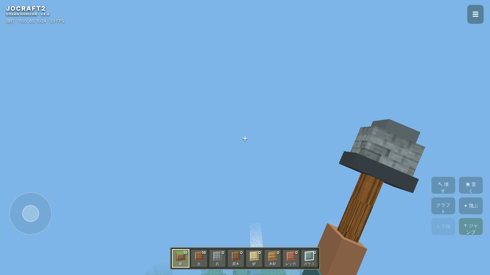 | 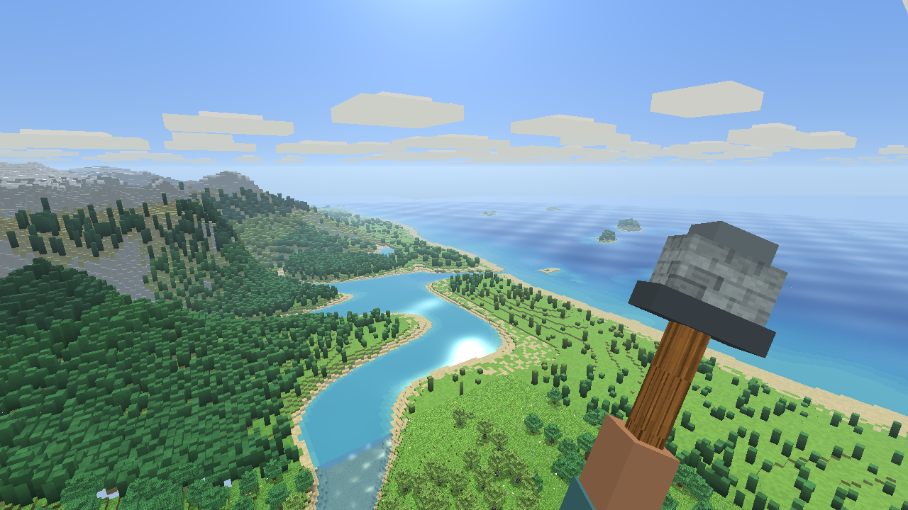 |
| 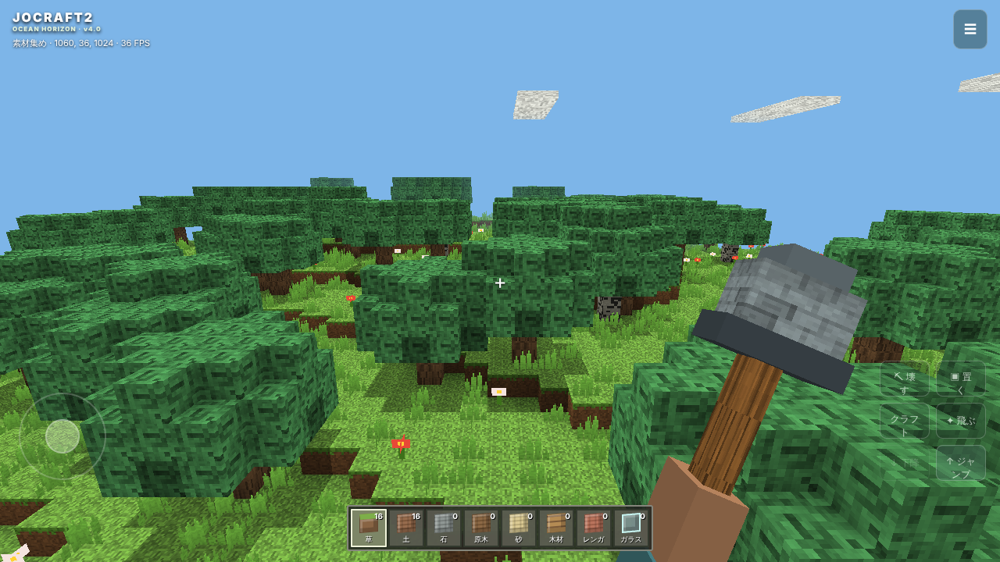 | 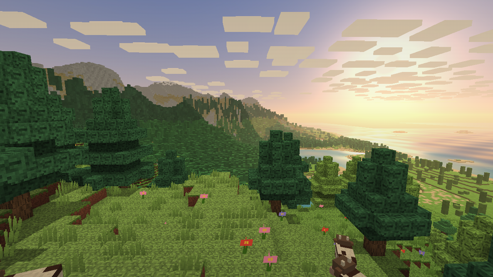 |

**地形（新規ワールドのみ, terrainVersion 4）**
- 高さ上限96→192、海面62。シード付きグラディエントノイズ＋ドメインワープ
- 東の長い海岸線（湾・岬）、沖の島々、世界の縁は外洋
- 内陸のリッジノイズ山脈（最高峰は約170、雪線・岩肌）、川が谷を刻んで海へ、森の湖
- 湿度×標高のバイオーム：草原・花畑・広葉樹林・白樺林・針葉樹（高地）・低木。樹木は5種類
- 「海を見下ろす高台」評価地点を自動探索。新規ワールドの出発地点＝タイトル背景

**描画**
- 近景：16×16チャンクを正方リング単位で段階生成、完成リングのみ描画、視錐台カリング、インデックス付き四角形
- 遠景：32×32セルのLODクアッドツリー（セル2〜16ブロック）を数行ずつ分割生成。近景の範囲は穴あけで重複なし
- 近景・遠景で深度を分けた2パス描画。ワールド外も水平線まで海
- 空のグラデーションと太陽、距離・高度依存の大気遠近（遠い山が青白く霞む）、水面のフレネル反射とスペキュラ
- タイトルは夕方の光、ゲーム中は昼の光。雲は静的メッシュをずらして流す
- シェーダーの頂点・フラグメント間で共有uniformを持たない構成（iOSの精度不一致によるリンク失敗を防止）。風・波の時計がfp16で劣化する問題も解消
- 遠景シェーダーが使えない端末では近景のみで動作。WebGLコンテキスト喪失から復帰

**性能・画質**
- 画質：低（近景3チャンク/遠景640）・標準（5/1150）・高（7/1800）。タイトルの「画質」ボタンで切替・記憶
- FPSが下がると描画解像度を自動で60%まで下げ、余裕があれば戻す
- デスクトップChromium計測：近景チャンク1枚 約1.4ms、地形列 約1µs、LODタイル 約4.4ms（複数フレームに分割）

**互換性**
- 旧ワールド（v1〜v3）は元の生成器・高さ96のまま。旧地形はv4.1とバイト単位で一致することをテストで確認。旧ワールドにも遠景が付く
- 遠景LODは生成器の地形を表示するため、遠くの建築物は近づくまで表示されません

**未検証**：iPhone 16 / A16 iPad 実機でのFPS・発熱・メモリ。開発環境はCPUレンダリング（SwiftShader）のためFPS値は参考になりません。

## v5.1 — LIVING NATURE（Phase 3）

| 朝 | 夕方 | 夜 |
|---|---|---|
| 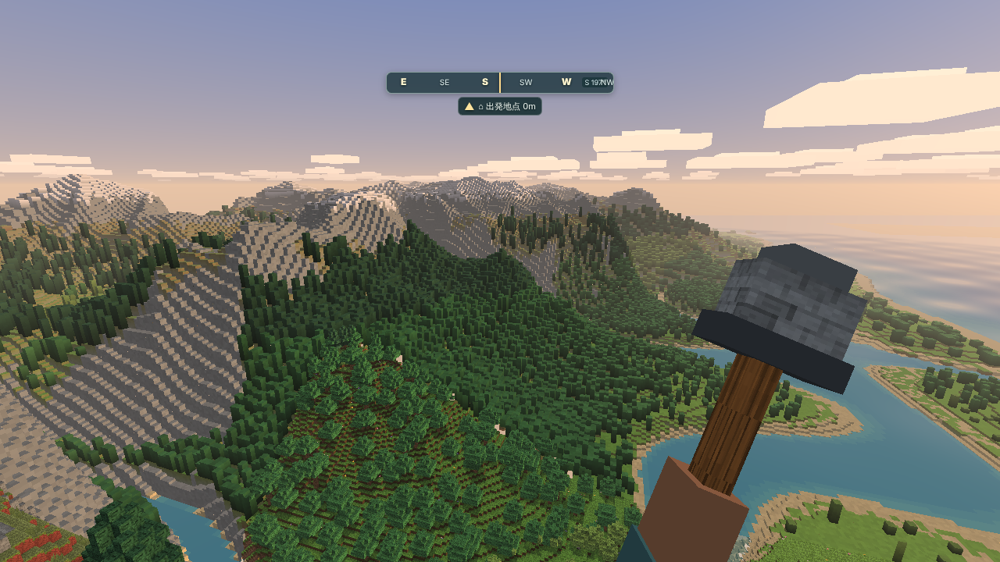 | 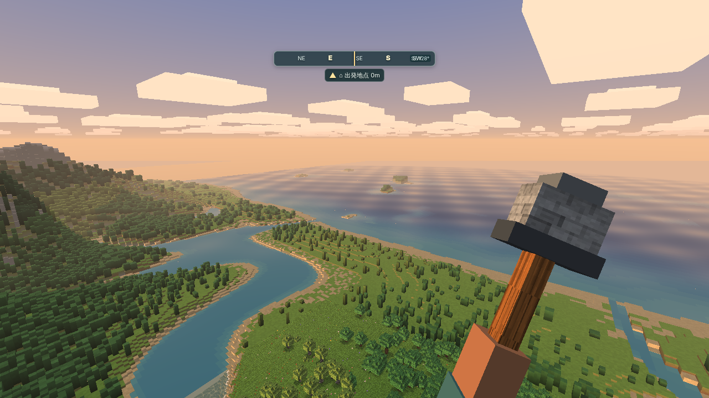 | 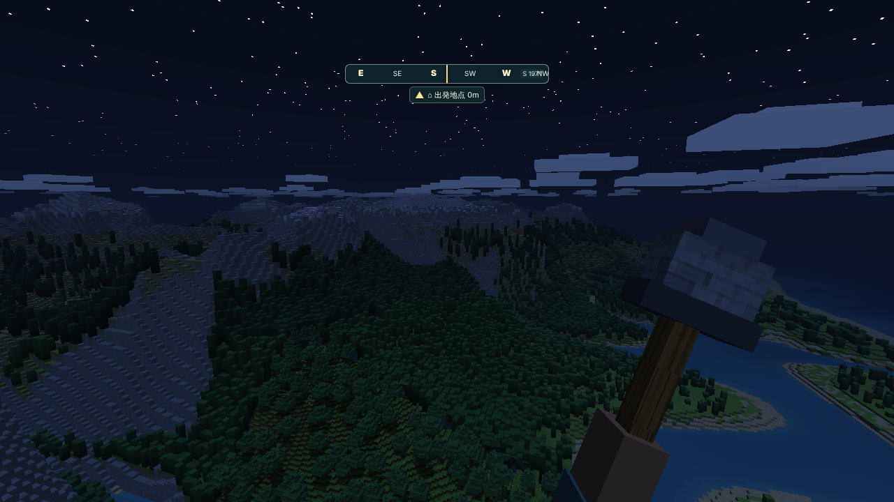 |

- **時間の流れ**：1日20分（夜は2.5倍速）。太陽は東から昇り西へ沈む。HUDに時刻（☀/☾）表示、時刻はセーブに保存
- **光**：面の向きと太陽方向からシェーダーで照明（直射＋空/地面の環境光）。夕日で斜面が橙に染まり、夜は月明かりと星空
- **木漏れ日**：樹冠の下の面は直射を失い、風で流れるピクセル状の光斑だけが差し込む
- **水**：水深で透明な浅瀬→ターコイズ→深い青に変化。波打ち際の白い泡、浅い水底のコースティクス（光の網目）、水中から見上げた水面
- **風**：強弱を繰り返す風を草・花・葉・雲が共有。葉は頂点位置だけで揺らすので隙間が開かず、地面・幹・根元は動かない
- 水中では遠景パスを省略（霧で見えないため軽量化）
- タイトル画面は従来通り夕方の固定光
- 開発用：URLに `?time=0.74` を付けると時刻を固定できる

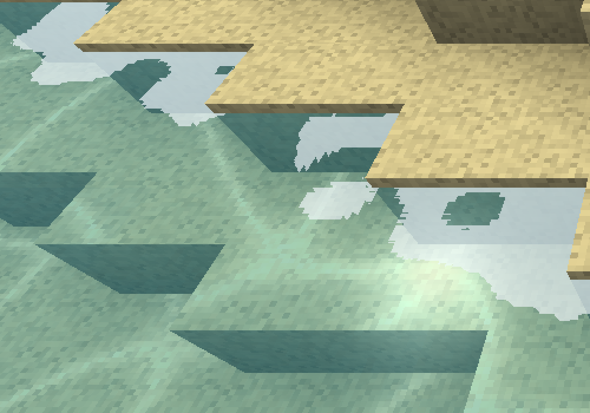

**未検証**：iPhone / iPad 実機での負荷（ピクセルシェーダーの計算が増えています）。

## v5.2 — PERFORMANCE（Phase 4）

- **遠景LODをWeb Workerで生成**：地形の計算を別スレッドへ。メインスレッドの遠景処理は平均1.5ms→0.15ms、最大12.4ms→4.4ms（デスクトップChromium計測）。Workerが使えない環境は従来の分割生成に自動で切替
- **画質の自動選択**：初回はCPUコア数・メモリ・タッチ端末かどうかで「低／標準／高」を選ぶ（iPhoneは標準）。手動で選んだ画質は記憶。URLの `?quality=low|standard|high` で一時的に指定も可能
- **負荷への適応**：FPSが下がると描画解像度に加えて地形生成の時間配分も半分に。重い状態が続くと画質を下げる案内を一度だけ表示
- **メモリ上限**：遠景タイル数の上限を画質ごとに設定（低140／標準220／高320）
- **性能計測モード**：`?bench`（タイトルの「操作方法を見る」内のリンク）で約35秒の自動飛行を行い、平均FPS・1%低下FPS・最悪フレーム・GPU推定メモリなどを表示。**セーブは一切変更しない**ので実機でそのまま計測できる

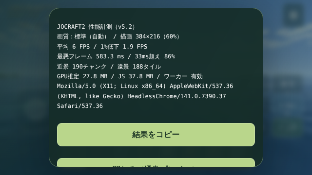

**実機計測のお願い**：iPhone 16 / A16 iPad で `?bench` を実行し、「結果をコピー」の内容を共有してもらえれば、それを基準に次の調整を行えます。開発環境（CPUレンダリング）のFPSは実機の参考になりません。

### 景色を楽しむHUD

- 通常HUDは時刻とプレイ状態を表示。座標・FPS・画質はメニューの「詳細情報」で切替（PC: F3）。タイトル・バージョンはタイトル画面に表示します。
- メニューの「HUD：通常／最小」（PC: H）で表示を切替。最小でも移動、採掘、設置、クラフト、飛行、ホットバー、コンパスを使えます。HUDと詳細情報の設定は `jocraft2-hud` に保存し、ワールド保存とは分離しています。
- 右上の撮影ボタン、メニューの「スクショモード」、またはPCのPでスクショモードへ。HUD・操作ボタン・道具・選択枠を隠します。移動／採掘／設置を停止し、ドラッグ／スワイプで構図を調整できます。
- スクショモードは右上の「戻る」、P、Escapeで明示的に終了します。自動復帰はありません。復帰ボタンは画面に残ります。画像の保存には端末のスクリーンショット機能を使用してください。
- スクショモード自体は保存しません。切替時に長押し入力を解除し、終了後は元のHUD設定でプレイを続けられます。
- 操作ボタンとホットバースロットは最小44px。狭い幅（374px未満）ではホットバーを横スクロールできます。safe-areaを考慮した端配置にしています。

検証: `node check.cjs`（既存回帰テスト＋HUD設定保存、スクショ中の入力遮断／位置維持、復帰、タッチ長押し／キャンセル／視点操作）。今回の環境ではブラウザバイナリを取得できず、iPhone Safari実機・ブラウザでの見た目、タッチ操作感は未確認です。

## v6.0 — LIVING WILDS（Phase 6：植生と自然景観）

| 景色A：花畑の丘 | 景色B：森と湖畔 | 景色C：川沿いの草原 |
|---|---|---|
| 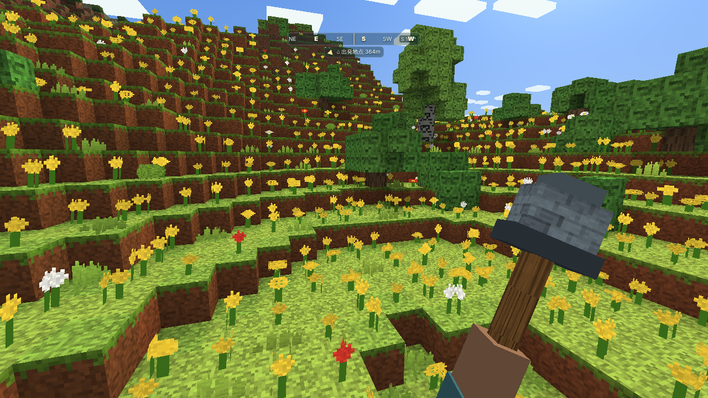 | 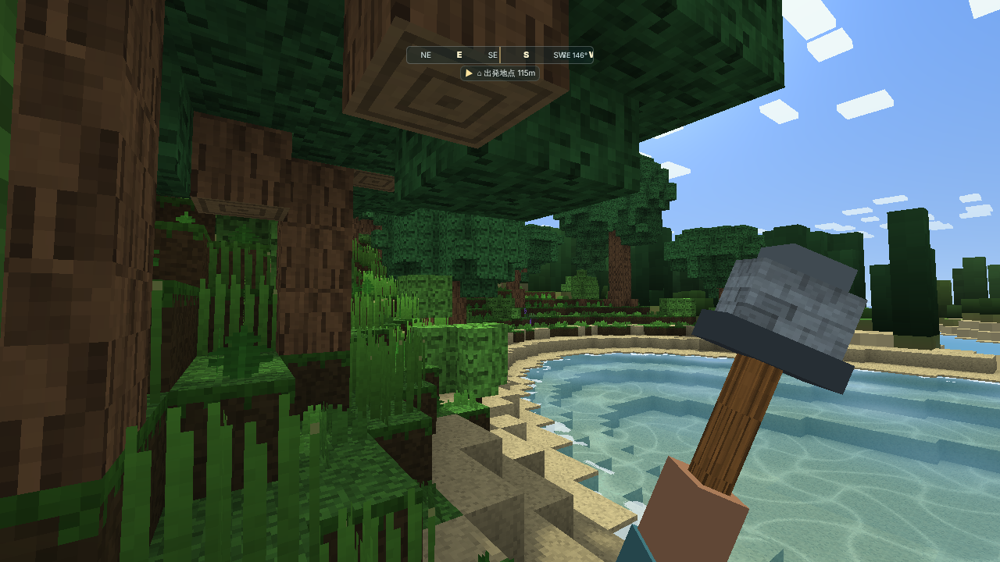 | 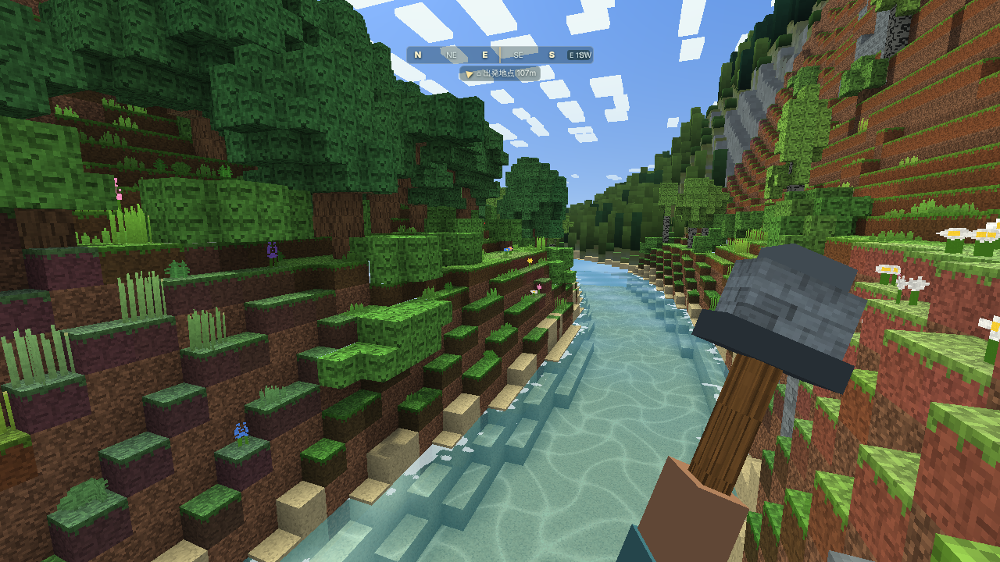 |

| 変更前（v5.2） | 変更後（v6.0） |
|---|---|
| 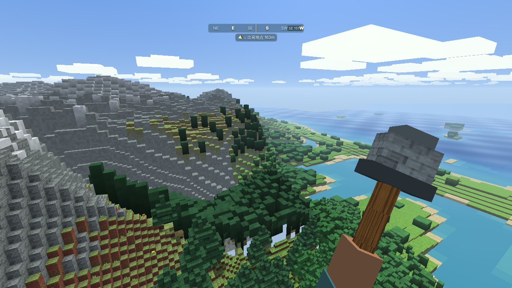 | 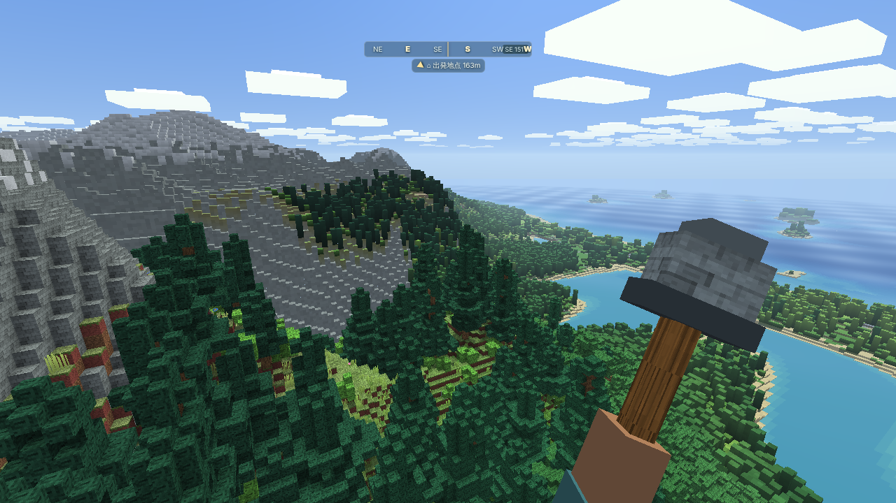 |

**新規ワールド（生成バージョン5）のみ**。既存ワールド（v4以前）の木・草・花・地形はビット単位で従来のまま（テストで確認）。

- **樹木の個体差**：広葉樹・白樺・針葉樹・低木すべてを、シードと座標から作るパラメータで生成
  - 若木／成木／老木の樹齢、高さ、幹の太さ（大木は2×2＋根の張り出し）、幹の傾き
  - 樹冠の横幅・高さ・非対称さ、副樹冠、枝（原木の枝＋先端の葉）、葉の密度（輪郭の欠け・空の透け）
  - まれに巨木（大きな広葉樹・巨大な針葉樹）。巨木の周りは小さな空き地になる
  - 葉は樹種ごとのブロック（白樺の葉・針葉・低木の葉）で色が異なり、さらに場所ごとに色調が揺らぐ
- **森林の分布**：湿度＋大規模クラスター＋小さな林間草地のノイズで、密林・疎林・草原が連続的に移り変わる。海岸・崖・森林限界で減少、標高とともに針葉樹へ。森の縁には低木が増える
- **草原**：短い草・長い草（穂付き）・シダ／葉の広い草・小さな茂み・まばらな雑草。日当たり（斜面の向き）、湿り気、広域の色調で、明るい黄緑〜深緑〜黄色がかった草原の「まとまり」を作る。土の見える場所も点在
- **花畑**：白・黄・赤・ピンク・紫・青の6色、形は4種（平花・カップ・穂状・小花）×花びら5パターン、高さも個体差。3段階の大きさのパッチ（小さな群落・中くらい・まれな広大な花畑）。同じパッチは同じ配色、さらに主色の群れと混色部分が分かれる。川沿いはアヤメ系、高地は小さな高山植物
- **風**：草は根元固定で先端ほどしなる。種類ごとに揺れの大きさが違う（短い草は小さく、長い草は大きく、花は茎から先）。突風の前線が地形を流れ、近くの植物が同じタイミングで揺れる。葉は樹冠ごとにゆっくり揺れる（GPU）
- **遠景**：森林密度に応じた樹冠の点在、樹種の色と高さ、花畑の色を地面に反映（遠くからでも花畑が色のまとまりで見える）
- **最適化**：画質ごとの植物密度（低0.4／標準0.75／高1）。プレイヤーから離れたチャンクは植物を間引き、移動に合わせて少しずつ作り直す。シェーダーでも距離に応じて植物をランダムに省略（低40／標準72／高110ブロック）
- 計測（デスクトップChromium）：近景1チャンクの生成〜メッシュ化 約2.5ms（v5.2は約1.4ms）。遠景タイルは同等でWorker内処理

**未検証**：iPhone 16 / A16 iPad 実機でのFPS。`?bench` の結果を共有してもらえれば、植物密度・フェード距離を実機に合わせて調整します。

## v7.0 — LIVING WATERS（Phase 7：海・川・波打ち際）

| 変更前（v6.0）→ 変更後（v7.0）：景色A 高台 / 景色B 砂浜 / 景色C 川 |
|---|
| 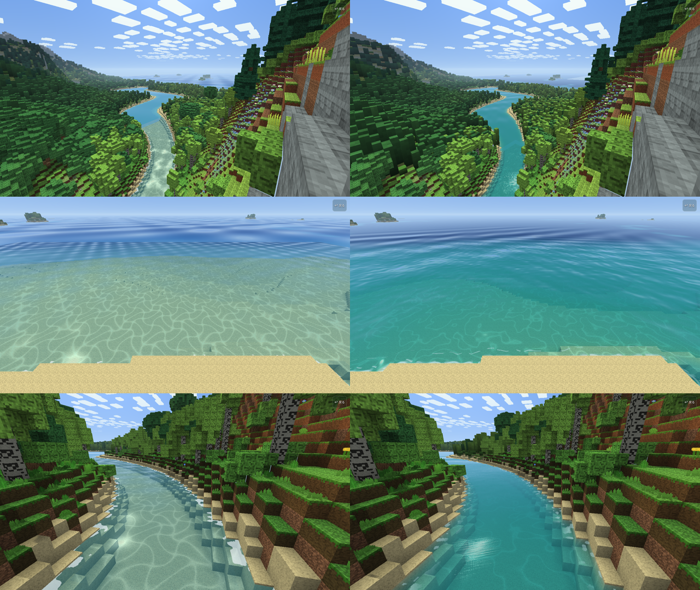 |

| 変更前 → 変更後：景色D 夕方の海 / 夜 / 水中 |
|---|
| 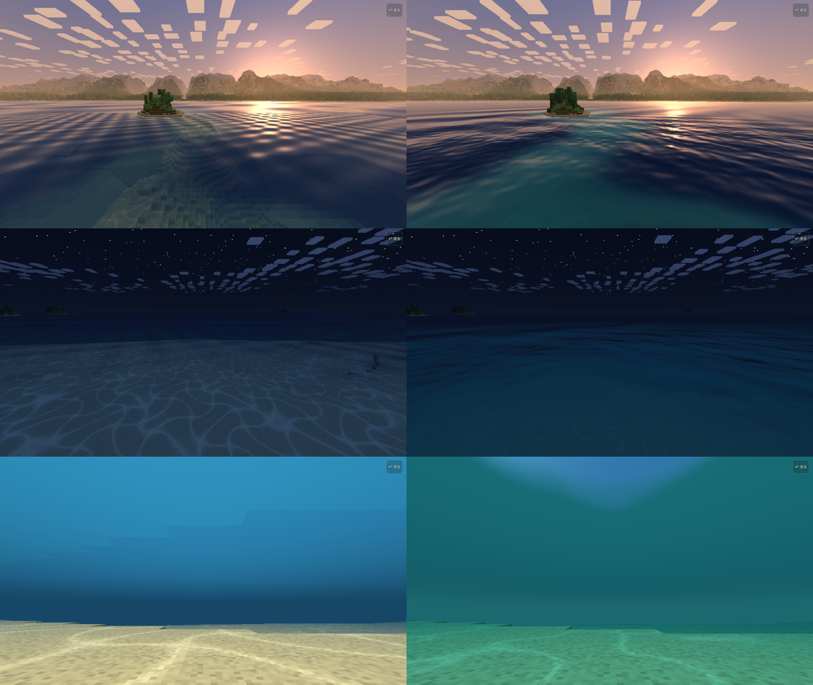 |

| 波打ち際 | 河口 | 朝の海 | 夕方の海 |
|---|---|---|---|
| 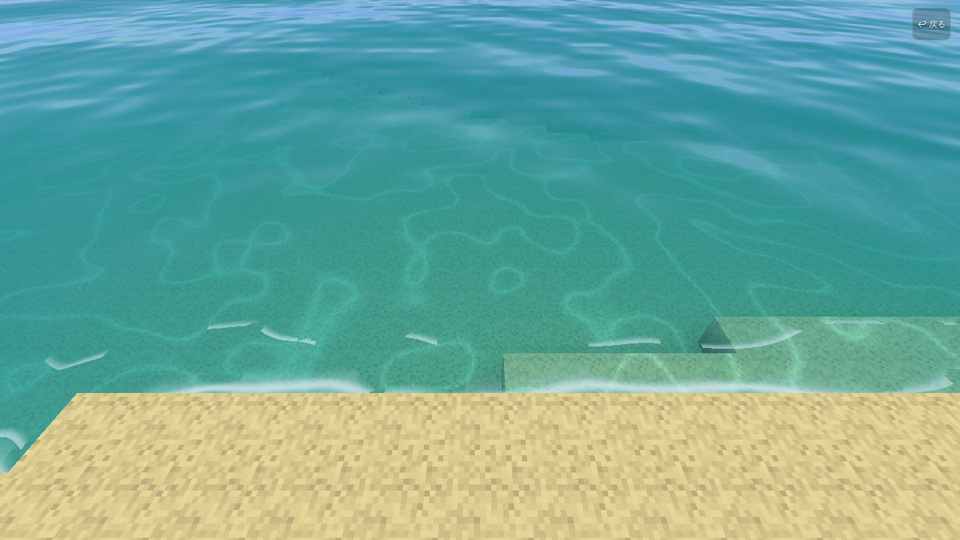 | 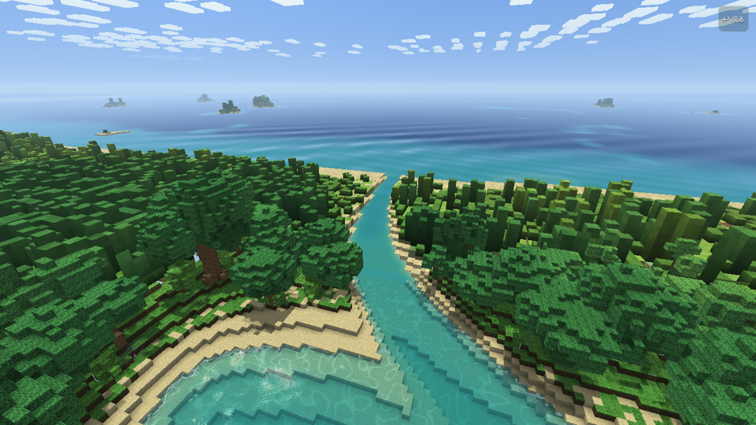 | 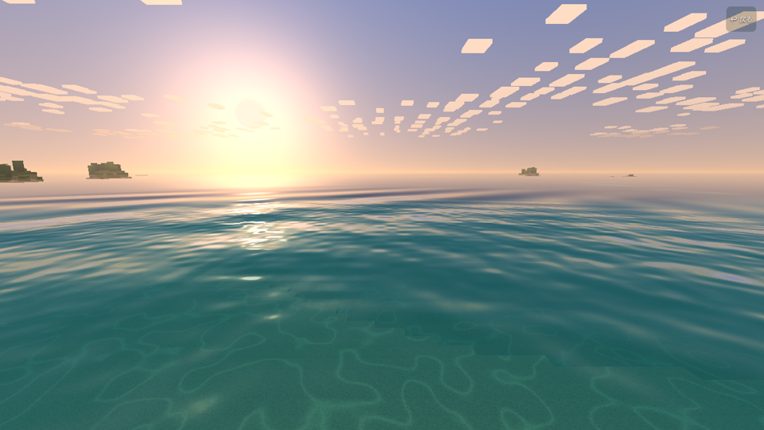 | 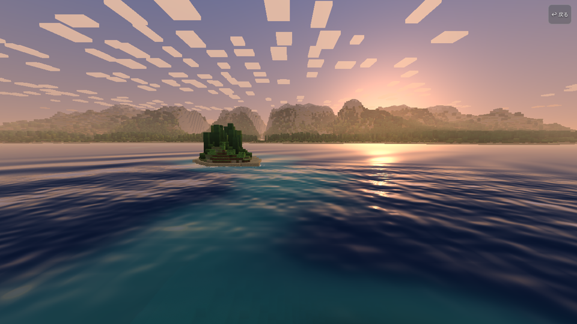 |

**地形・水の位置・セーブは一切変更なし**（変わるのはメッシュの頂点データとシェーダーだけ。既存ワールドもそのまま新しい水になる）。

- **横縞の原因と対策**：旧水面は似た向きの正弦波4本だけで、距離による減衰もなく、遠くでは低周波の波が水平の帯に見えていた。新しい水面は向き・波長がばらばらな5本の波＋流れるノイズで、長いうねりは「群れ」になって途切れる。1ピクセルが波長の半分を超えた成分から順に消すので、遠くの海は穏やかになり、縞模様（エイリアシング）が出ない
- **海の色と透明感**：水深・砂底の割合・視線の角度から色を決める。光は赤→緑の順に水に吸収されるため、浅い砂地は明るいターコイズ、深くなるほど鮮やかな青から濃い青へ移る。水深は4本の柱の平均を頂点ごとに持つので、ブロック単位の段差にならない。斜めから見るほど反射が強く、水底が見えにくくなる（フレネル）
- **近景と遠景の継ぎ目**：遠景（LOD）の水にも水深と砂底の割合を渡して、同じ式で計算する。近景の正方形の縁から空の色が透けていた隙間も解消
- **波打ち際**：岸からの距離（最大3.5ブロック）を頂点ごとに持つ。細い白波が寄せては引き、外海に面した海岸では砕け波が岸に向かって進む。岩場では細かい泡が出る。場所ごとに時間差があるので一斉には点滅せず、沖には泡が出ない。湖・入り江・川は穏やか
- **川の流れ**：川を作るノイズの等高線から流れの向きを計算する。海（東）へ向かって流れ、狭い所ほど速く、曲がり角では向きが変わる。流れに沿って伸びた波紋が下流へ動き、2つの位相を交互に重ねるので模様が崩れない。河口では流れが海に溶けていき、水面の高さと色はつながったまま
- **光**：朝は斜めの柔らかい反射、昼は青い海ときらめき、夕方は夕焼けの空の反射と水平線へ伸びる光の道、夜は月明かりだけの暗い水面。遠くほど反射の光が広がる。既存の太陽・月・空の色をそのまま使う
- **水中**：カメラの深さで色が変わる（浅いと青緑、深いと青）。遠くは赤から順に色を失い、水中の霧に溶ける。上を見るとスネルの窓（空の見える円）。水底の光の揺らぎは、2層のノイズによる不規則な模様にした（夜は弱める）。水中で遠景を描かない最適化はそのまま
- **最適化**：ポリゴンは増やしていない。水面（とガラス）は専用のシェーダープログラムで描くので、地形のシェーダーは軽いまま。画質ごとに水面の細かさを3段階で切り替え（低：波のみ／標準：ノイズ1層／高：2層）。遠景の水は細かいノイズを省く。水シェーダーのコンパイルに失敗したときは軽量版、それも失敗したら単色の水で描画し、画面が真っ白・真っ黒になることはない

**未検証**：iPhone 16 / A16 iPad 実機でのFPS（60FPS達成とは言えない）。CPU描画のSwiftShaderでの比較では、水の多い場面で1フレームが約1.1〜1.2倍、陸地のみの場面でも約1.2倍、`?bench` の平均は 5.3→4.5 FPS（標準画質・640×360）になった（SwiftShaderは分岐を両方実行するので、実機GPUより不利に出ている可能性が高い）。`?bench` の結果を共有してもらえれば、実機に合わせて調整します。
