# ジョークラ2

依存ライブラリ不要のオリジナル3Dブロック建築ゲーム。`index.html` をブラウザで開くだけで起動します。

- 2048×2048×192の自動生成地形：山脈、渓谷、川、湖、森、草原、砂浜、島、海（新規ワールド）、大滝・大渓谷・天然アーチ・海底地形などの絶景
- 近景はボクセル、遠景は軽量LODで最大約1800ブロック先まで描画（画質設定で切替）
- 一人称移動、重力、ジャンプ、衝突判定、ブロック採掘・設置
- 素材集め / 自由建築、8種類のホットバー、3種類のクラフト
- スマホのマルチタッチ操作とPCのキーボード・マウス操作
- 15秒ごとのブラウザ内保存、再開、出発地点への復帰
- 画面上部の探索コンパス：N/E/S/Wの向き、出発地点までの方向・距離、端まで100ブロック以内の警告

スマホ：左スティック移動、画面スワイプ視点、右ボタンで採掘・設置・ジャンプ。コンパスの▲は出発地点の方向を示します。
PC：WASD、Space、左クリック採掘、右クリック設置、1〜8選択、Eクラフト、Escメニュー。

保存データは端末・ブラウザ単位です。新しい世界は確認後に現在のセーブを削除します。
現バージョンは有限の建築用ワールドです。敵との戦闘はサバイバルモードのみ（v15.0）。鉱石・ツルハシ・防具・宝箱・洞窟モンスターは v16.0。マルチプレイ・本家の全要素は含みません。

## 確認

`node check.cjs` — メッシュ数値、スポーン、境界・床衝突、保存復元、重力着地、地形構成、LOD、旧セーブ互換（旧地形のバイト一致）、コンパスの方角・境界警告を検証。
実機の描画性能・タッチ操作は別途確認が必要です。

## 公開

GitHub Settings → Pages → Deploy from a branch → main / (root) で公開できます。

Minecraft公式作品ではありません。コードとブロックの外観は独自実装です。

## v2.0 — FOREST UPDATE

- 草・土・岩・樹皮・年輪・白樺・木材・レンガに独自のピクセル模様
- 頂点ごとの周辺遮蔽と樹冠の陰影、半透明の水・ガラス
- 草花、移動するブロック雲、歩く牛（脚のアニメーション）
- 一人称の手とシャベル、採掘アニメーションと破片
- 新規ワールドは出発地点の近くに湖。既存セーブは以前の地形を維持
- タッチ移動時の段差オートジャンプ、コンパクトなホットバー

以前の世界を残したまま、見た目と動物は更新されます。新しい地形が必要な場合のみメニューの「新しい世界」を選択してください（確認後に既存セーブを消去）。

確認済み：Nodeによるゲーム処理の回帰検証、GLES2による実シェーダーのコンパイルと静止画レンダリング。スマホ実機のタッチ操作・フレームレートは未確認。

## v3.0 — SKY EXPLORER

- フォーカス喪失からタイトルを開く処理を廃止。非表示中のみ動作を休止し、復帰後は同じゲーム画面を再開
- 同じタブが再読み込みされた場合も、プレイ中だったセッションは保存地点から再開
- 飛行切替：スマホ「飛ぶ」、PC F。上昇：↑ / Space、下降：↓ / Q / Ctrl。再度切替で通常歩行
- ワールドを64×64から256×256へ拡張（面積16倍）、高さ上限40から96へ
- 周辺チャンクのみ段階的にメッシュ化。離れたGPUバッファを破棄してメモリを制限
- 以前のセーブの64幅インデックスを新しい座標へ移行。建築・持ち物・現在地を引き継ぎ

回帰テスト：フォーカス喪失、非表示/復帰、セッション再開、飛行の上昇/静止/下降/天井・ブロック衝突、旧セーブ移行、遠方の建築保存、チャンク数の上限、明示的メニュー操作。

## v4.0 — OCEAN HORIZON

- ワールド幅を256から2048へ。陸と海を含む探索面積は従来の64倍
- ブロックを起動時に全生成せず、8×8の区画ごとに必要な場所だけ自動生成
- 通り過ぎた区画のCPU/GPUデータを解放し、建築変更のみ保存するストリーミング方式
- 新しいワールドは(1024,1024)付近から開始。東へ進むと砂浜・大きな海へ続く
- 描画半径を6区画から8区画に拡大（スマホの実機性能は要確認）
- 旧64/256幅のセーブは建築・位置・持ち物を維持。以前の世界で端にいる場合は「出発地点へ」で中央に移動できる
- 海や森の分布が更新されるのは新しいワールドのみ。現在の世界を残すなら「新しい世界」は押さないでください

**注**：世界全体を一括でGPUに描画するわけではありません。広さと同時描画量は別々に制御します。

## v5.0 — GRAND VISTA

| 改善前 | 改善後 |
|---|---|
|  |  |
|  |  |

**地形（新規ワールドのみ, terrainVersion 4）**
- 高さ上限96→192、海面62。シード付きグラディエントノイズ＋ドメインワープ
- 東の長い海岸線（湾・岬）、沖の島々、世界の縁は外洋
- 内陸のリッジノイズ山脈（最高峰は約170、雪線・岩肌）、川が谷を刻んで海へ、森の湖
- 湿度×標高のバイオーム：草原・花畑・広葉樹林・白樺林・針葉樹（高地）・低木。樹木は5種類
- 「海を見下ろす高台」評価地点を自動探索。新規ワールドの出発地点＝タイトル背景

**描画**
- 近景：16×16チャンクを正方リング単位で段階生成、完成リングのみ描画、視錐台カリング、インデックス付き四角形
- 遠景：32×32セルのLODクアッドツリー（セル2〜16ブロック）を数行ずつ分割生成。近景の範囲は穴あけで重複なし
- 近景・遠景で深度を分けた2パス描画。ワールド外も水平線まで海
- 空のグラデーションと太陽、距離・高度依存の大気遠近（遠い山が青白く霞む）、水面のフレネル反射とスペキュラ
- タイトルは夕方の光、ゲーム中は昼の光。雲は静的メッシュをずらして流す
- シェーダーの頂点・フラグメント間で共有uniformを持たない構成（iOSの精度不一致によるリンク失敗を防止）。風・波の時計がfp16で劣化する問題も解消
- 遠景シェーダーが使えない端末では近景のみで動作。WebGLコンテキスト喪失から復帰

**性能・画質**
- 画質：低（近景3チャンク/遠景640）・標準（5/1150）・高（7/1800）。タイトルの「画質」ボタンで切替・記憶
- FPSが下がると描画解像度を自動で60%まで下げ、余裕があれば戻す
- デスクトップChromium計測：近景チャンク1枚 約1.4ms、地形列 約1µs、LODタイル 約4.4ms（複数フレームに分割）

**互換性**
- 旧ワールド（v1〜v3）は元の生成器・高さ96のまま。旧地形はv4.1とバイト単位で一致することをテストで確認。旧ワールドにも遠景が付く
- 遠景LODは生成器の地形を表示するため、遠くの建築物は近づくまで表示されません

**未検証**：iPhone 16 / A16 iPad 実機でのFPS・発熱・メモリ。開発環境はCPUレンダリング（SwiftShader）のためFPS値は参考になりません。

## v5.1 — LIVING NATURE（Phase 3）

| 朝 | 夕方 | 夜 |
|---|---|---|
|  |  |  |

- **時間の流れ**：1日20分（夜は2.5倍速）。太陽は東から昇り西へ沈む。HUDに時刻（☀/☾）表示、時刻はセーブに保存
- **光**：面の向きと太陽方向からシェーダーで照明（直射＋空/地面の環境光）。夕日で斜面が橙に染まり、夜は月明かりと星空
- **木漏れ日**：樹冠の下の面は直射を失い、風で流れるピクセル状の光斑だけが差し込む
- **水**：水深で透明な浅瀬→ターコイズ→深い青に変化。波打ち際の白い泡、浅い水底のコースティクス（光の網目）、水中から見上げた水面
- **風**：強弱を繰り返す風を草・花・葉・雲が共有。葉は頂点位置だけで揺らすので隙間が開かず、地面・幹・根元は動かない
- 水中では遠景パスを省略（霧で見えないため軽量化）
- タイトル画面は従来通り夕方の固定光
- 開発用：URLに `?time=0.74` を付けると時刻を固定できる

**未検証**：iPhone / iPad 実機での負荷（ピクセルシェーダーの計算が増えています）。

## v5.2 — PERFORMANCE（Phase 4）

- **遠景LODをWeb Workerで生成**：地形の計算を別スレッドへ。メインスレッドの遠景処理は平均1.5ms→0.15ms、最大12.4ms→4.4ms（デスクトップChromium計測）。Workerが使えない環境は従来の分割生成に自動で切替
- **画質の自動選択**：初回はCPUコア数・メモリ・タッチ端末かどうかで「低／標準／高」を選ぶ（iPhoneは標準）。手動で選んだ画質は記憶。URLの `?quality=low|standard|high` で一時的に指定も可能
- **負荷への適応**：FPSが下がると描画解像度に加えて地形生成の時間配分も半分に。重い状態が続くと画質を下げる案内を一度だけ表示
- **メモリ上限**：遠景タイル数の上限を画質ごとに設定（低140／標準220／高320）
- **性能計測モード**：`?bench`（タイトルの「操作方法を見る」内のリンク）で約35秒の自動飛行を行い、平均FPS・1%低下FPS・最悪フレーム・GPU推定メモリなどを表示。**セーブは一切変更しない**ので実機でそのまま計測できる

**実機計測のお願い**：iPhone 16 / A16 iPad で `?bench` を実行し、「結果をコピー」の内容を共有してもらえれば、それを基準に次の調整を行えます。開発環境（CPUレンダリング）のFPSは実機の参考になりません。

### 景色を楽しむHUD

- 通常HUDは時刻とプレイ状態を表示。座標・FPS・画質はメニューの「詳細情報」で切替（PC: F3）。タイトル・バージョンはタイトル画面に表示します。
- メニューの「HUD：通常／最小」（PC: H）で表示を切替。最小でも移動、採掘、設置、クラフト、飛行、ホットバー、コンパスを使えます。HUDと詳細情報の設定は `jocraft2-hud` に保存し、ワールド保存とは分離しています。
- 右上の撮影ボタン、メニューの「スクショモード」、またはPCのPでスクショモードへ。HUD・操作ボタン・道具・選択枠を隠します。移動／採掘／設置を停止し、ドラッグ／スワイプで構図を調整できます。
- スクショモードは右上の「戻る」、P、Escapeで明示的に終了します。自動復帰はありません。復帰ボタンは画面に残ります。画像の保存には端末のスクリーンショット機能を使用してください。
- スクショモード自体は保存しません。切替時に長押し入力を解除し、終了後は元のHUD設定でプレイを続けられます。
- 操作ボタンとホットバースロットは最小44px。狭い幅（374px未満）ではホットバーを横スクロールできます。safe-areaを考慮した端配置にしています。

検証: `node check.cjs`（既存回帰テスト＋HUD設定保存、スクショ中の入力遮断／位置維持、復帰、タッチ長押し／キャンセル／視点操作）。今回の環境ではブラウザバイナリを取得できず、iPhone Safari実機・ブラウザでの見た目、タッチ操作感は未確認です。

## v6.0 — LIVING WILDS（Phase 6：植生と自然景観）

| 景色A：花畑の丘 | 景色B：森と湖畔 | 景色C：川沿いの草原 |
|---|---|---|
|  |  |  |

| 変更前（v5.2） | 変更後（v6.0） |
|---|---|
|  |  |

**新規ワールド（生成バージョン5）のみ**。既存ワールド（v4以前）の木・草・花・地形はビット単位で従来のまま（テストで確認）。

- **樹木の個体差**：広葉樹・白樺・針葉樹・低木すべてを、シードと座標から作るパラメータで生成
  - 若木／成木／老木の樹齢、高さ、幹の太さ（大木は2×2＋根の張り出し）、幹の傾き
  - 樹冠の横幅・高さ・非対称さ、副樹冠、枝（原木の枝＋先端の葉）、葉の密度（輪郭の欠け・空の透け）
  - まれに巨木（大きな広葉樹・巨大な針葉樹）。巨木の周りは小さな空き地になる
  - 葉は樹種ごとのブロック（白樺の葉・針葉・低木の葉）で色が異なり、さらに場所ごとに色調が揺らぐ
- **森林の分布**：湿度＋大規模クラスター＋小さな林間草地のノイズで、密林・疎林・草原が連続的に移り変わる。海岸・崖・森林限界で減少、標高とともに針葉樹へ。森の縁には低木が増える
- **草原**：短い草・長い草（穂付き）・シダ／葉の広い草・小さな茂み・まばらな雑草。日当たり（斜面の向き）、湿り気、広域の色調で、明るい黄緑〜深緑〜黄色がかった草原の「まとまり」を作る。土の見える場所も点在
- **花畑**：白・黄・赤・ピンク・紫・青の6色、形は4種（平花・カップ・穂状・小花）×花びら5パターン、高さも個体差。3段階の大きさのパッチ（小さな群落・中くらい・まれな広大な花畑）。同じパッチは同じ配色、さらに主色の群れと混色部分が分かれる。川沿いはアヤメ系、高地は小さな高山植物
- **風**：草は根元固定で先端ほどしなる。種類ごとに揺れの大きさが違う（短い草は小さく、長い草は大きく、花は茎から先）。突風の前線が地形を流れ、近くの植物が同じタイミングで揺れる。葉は樹冠ごとにゆっくり揺れる（GPU）
- **遠景**：森林密度に応じた樹冠の点在、樹種の色と高さ、花畑の色を地面に反映（遠くからでも花畑が色のまとまりで見える）
- **最適化**：画質ごとの植物密度（低0.4／標準0.75／高1）。プレイヤーから離れたチャンクは植物を間引き、移動に合わせて少しずつ作り直す。シェーダーでも距離に応じて植物をランダムに省略（低40／標準72／高110ブロック）
- 計測（デスクトップChromium）：近景1チャンクの生成〜メッシュ化 約2.5ms（v5.2は約1.4ms）。遠景タイルは同等でWorker内処理

**未検証**：iPhone 16 / A16 iPad 実機でのFPS。`?bench` の結果を共有してもらえれば、植物密度・フェード距離を実機に合わせて調整します。

## v7.0 — LIVING WATERS（Phase 7：海・川・波打ち際）

| 変更前（v6.0）→ 変更後（v7.0）：景色A 高台 / 景色B 砂浜 / 景色C 川 |
|---|
|  |

| 変更前 → 変更後：景色D 夕方の海 / 夜 / 水中 |
|---|
|  |

| 波打ち際 | 河口 | 朝の海 | 夕方の海 |
|---|---|---|---|
|  |  |  |  |

**地形・水の位置・セーブは一切変更なし**（変わるのはメッシュの頂点データとシェーダーだけ。既存ワールドもそのまま新しい水になる）。

- **横縞の原因と対策**：旧水面は似た向きの正弦波4本だけで、距離による減衰もなく、遠くでは低周波の波が水平の帯に見えていた。新しい水面は向き・波長がばらばらな5本の波＋流れるノイズで、長いうねりは「群れ」になって途切れる。1ピクセルが波長の半分を超えた成分から順に消すので、遠くの海は穏やかになり、縞模様（エイリアシング）が出ない
- **海の色と透明感**：水深・砂底の割合・視線の角度から色を決める。光は赤→緑の順に水に吸収されるため、浅い砂地は明るいターコイズ、深くなるほど鮮やかな青から濃い青へ移る。水深は4本の柱の平均を頂点ごとに持つので、ブロック単位の段差にならない。斜めから見るほど反射が強く、水底が見えにくくなる（フレネル）
- **近景と遠景の継ぎ目**：遠景（LOD）の水にも水深と砂底の割合を渡して、同じ式で計算する。近景の正方形の縁から空の色が透けていた隙間も解消
- **波打ち際**：岸からの距離（最大3.5ブロック）を頂点ごとに持つ。細い白波が寄せては引き、外海に面した海岸では砕け波が岸に向かって進む。岩場では細かい泡が出る。場所ごとに時間差があるので一斉には点滅せず、沖には泡が出ない。湖・入り江・川は穏やか
- **川の流れ**：川を作るノイズの等高線から流れの向きを計算する。海（東）へ向かって流れ、狭い所ほど速く、曲がり角では向きが変わる。流れに沿って伸びた波紋が下流へ動き、2つの位相を交互に重ねるので模様が崩れない。河口では流れが海に溶けていき、水面の高さと色はつながったまま
- **光**：朝は斜めの柔らかい反射、昼は青い海ときらめき、夕方は夕焼けの空の反射と水平線へ伸びる光の道、夜は月明かりだけの暗い水面。遠くほど反射の光が広がる。既存の太陽・月・空の色をそのまま使う
- **水中**：カメラの深さで色が変わる（浅いと青緑、深いと青）。遠くは赤から順に色を失い、水中の霧に溶ける。上を見るとスネルの窓（空の見える円）。水底の光の揺らぎは、2層のノイズによる不規則な模様にした（夜は弱める）。水中で遠景を描かない最適化はそのまま
- **最適化**：ポリゴンは増やしていない。水面（とガラス）は専用のシェーダープログラムで描くので、地形のシェーダーは軽いまま。画質ごとに水面の細かさを3段階で切り替え（低：波のみ／標準：ノイズ1層／高：2層）。遠景の水は細かいノイズを省く。水シェーダーのコンパイルに失敗したときは軽量版、それも失敗したら単色の水で描画し、画面が真っ白・真っ黒になることはない

**未検証**：iPhone 16 / A16 iPad 実機でのFPS（60FPS達成とは言えない）。CPU描画のSwiftShaderでの比較では、水の多い場面で1フレームが約1.1〜1.2倍、陸地のみの場面でも約1.2倍、`?bench` の平均は 5.3→4.5 FPS（標準画質・640×360）になった（SwiftShaderは分岐を両方実行するので、実機GPUより不利に出ている可能性が高い）。`?bench` の結果を共有してもらえれば、実機に合わせて調整します。

## v8.0 — SCENIC WORLD（Phase 8：絶景スポット）

| 変更前（v7.0）→ 変更後（v8.0）：同じワールド・同じ地点・同じ向き（左が前、右が後） |
|---|
| 海辺の崖 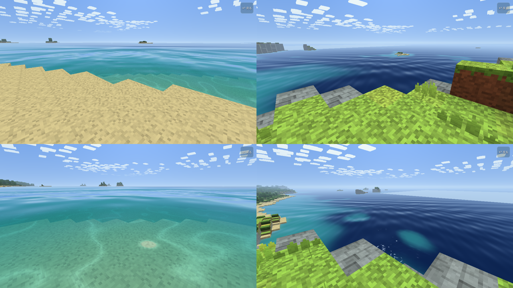 |
| 山頂 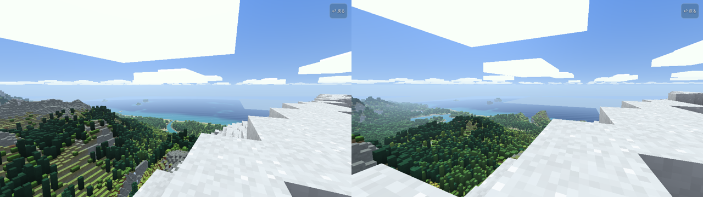 |
| 谷（上：川の峡谷、下：入り江に面した斜面） 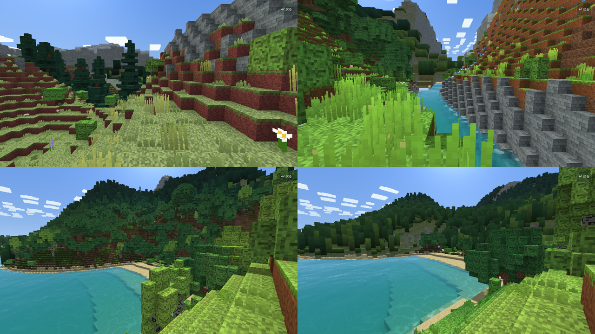 |

| ランドマークの山と海 | 川沿い平原 | 新しいタイトル背景 |
|---|---|---|
| 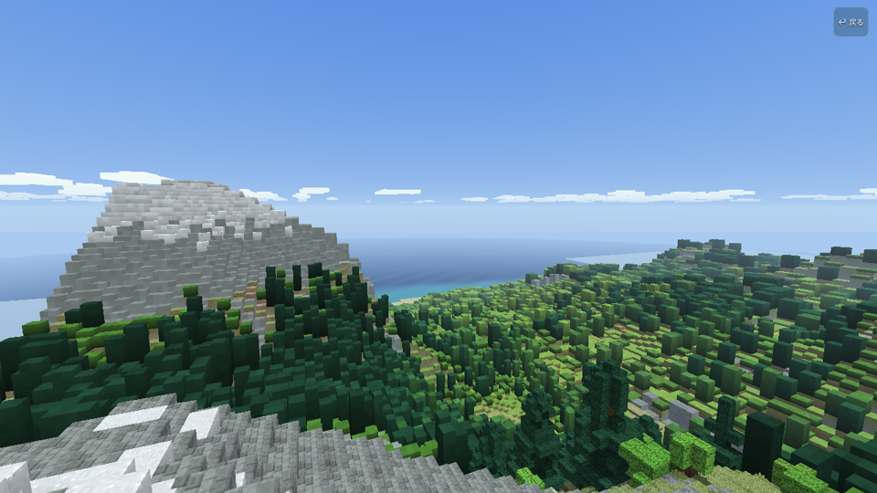 | 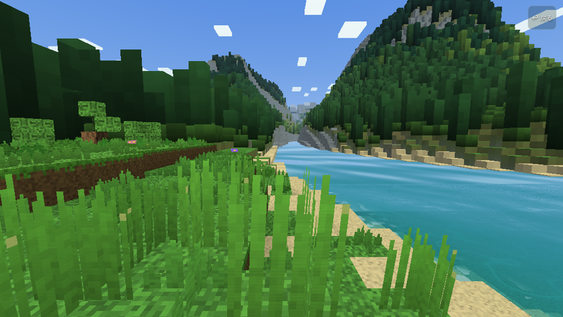 | 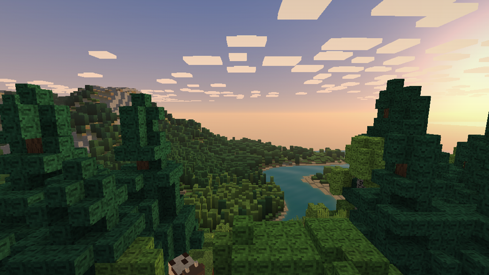 |

**新規ワールド（生成バージョン6）のみ**。既存ワールド（v5以前）は地形・ブロック・近景メッシュ・遠景タイルまでビット単位で従来のまま（テストで確認）。「新しい世界」を押すと v6 の世界になる。「絶景スポットへ」ボタンは既存ワールドでも使える。

- **海辺の崖**：海岸線に岬と入り江を追加し、場所ごとに「崖の多い海岸」と「砂浜の多い海岸」が変わる（崖の割合はワールドごとに約10〜55%）。崖は岸から数ブロックで立ち上がる急な壁と、その上の台地（高さ11〜40ブロック、場所ごとに違う）。段になった崖、崖の間の小さな入り江（崖の途中に砂浜）もある。急な岸は岩、緩い岸は砂になる。崖の下は急に深くなり、崖の上は風が強い草地のように木が少ない
- **山頂**：山脈の中に「ランドマークの峰」を追加。放射状に尾根が伸び、峰と峰の間には鞍部ができる。高さの上限は急に切らず、なめらかに頭打ちにする（山頂が平らにならない）。山頂は森林限界より上なので木が無く、岩と雪で見晴らしがいい
- **谷**：山の中に水の無い峡谷（谷底は草地）を追加。幅が広い所と狭い所があり、川の谷は広がりが強くなった。川は大きく蛇行し、川幅も場所ごとに変わる。急斜面は土が薄く、岩肌が見える
- **川沿い平原**：低地では谷が広い草原に開き、川に向かってゆるやかに低くなり、水際に低い土手がある。この一帯は森林密度を下げて、草原と花畑になるようにした（見通しと植生の両立）
- **見つけやすさ**：タイトルの「絶景スポットへ」で、その世界の崖・山頂・谷・川沿い平原の見どころを順番に巡れる。粗いグリッドで地形を評価し、候補を正確な地形で補正（山頂は頂上へ、崖は縁の手前へ、木の無い開けた場所へ）。評価は純粋にシードの関数なので全端末で同じ場所になる。探索は約0.2秒（フレーム分割で実行）
- **スタート地点・タイトル背景**：出発地点の評価に「崖の上から海を見下ろせるか」を追加し、森の中に埋もれた候補は減点
- **遠景**：新しい地形は遠景LODのWorkerとメインスレッドで同一（テストで確認）。崖や峰のシルエットがそのまま遠くから見える
- **最適化**：地形の追加計算は1列あたり約10%増（ランドマークの峰は1回計算したパラメータを使い回す）。描画負荷は増えていない
- 計測（デスクトップ・Node上）：近景1チャンクの生成 約27→30ms（+10%）、メッシュ化と遠景タイルは同等。`?bench`（SwiftShader・640×360・標準）の平均は v7.0 が4.5FPS、v8.0 が4.8FPS で差なし（SwiftShaderはCPU描画で、実機GPUの数字ではない）

**未検証**：iPhone 16 / A16 iPad 実機でのFPSと、新しい地形でのチャンク生成時間。`?bench` の結果を共有してもらえれば調整します。

## v9.0 — SKY & CLOUDS（Phase 9：雲と空）

| 変更前（v8.0）→ 変更後（v9.0）：同じ地点・同じ向き・同じ時刻（上：昼、下：夕方） |
|---|
| 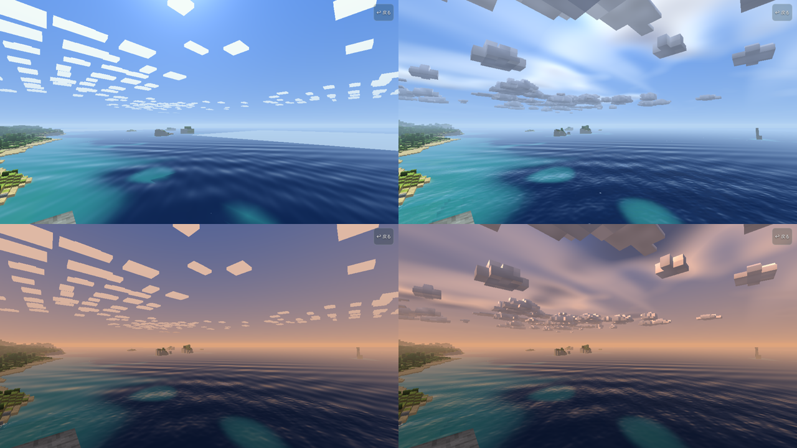 |

| 朝 / 夜 | 見上げた雲 |
|---|---|
| 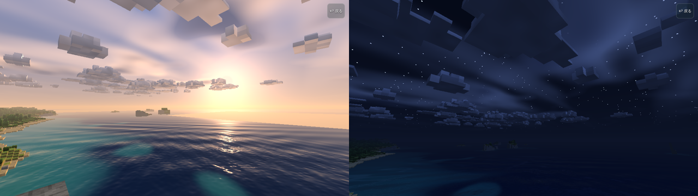 | 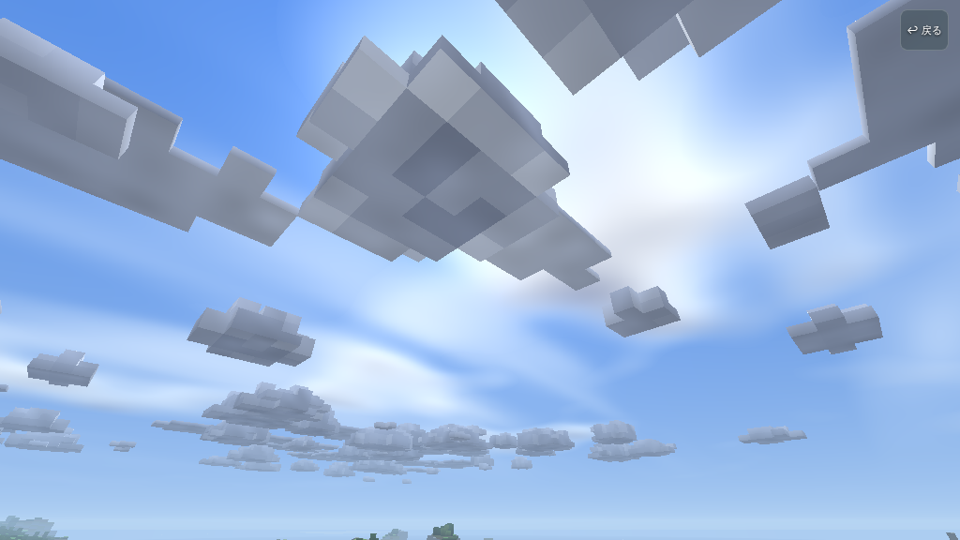 |

生成バージョンに関係なく、**既存ワールドもそのまま新しい空**になる（地形・セーブは変更なし）。

- **立体の雲**：白い板を、ブロックの塊でできた雲に作り直した。3種類を混ぜる：①そびえる積雲（平らな底、2〜4段の厚み、幅30〜70ブロック）、②薄い層雲、③小さな雲のかけら。形はボクセルの密度＋ノイズで決まり、1つとして同じ形がない。高さも3段階に散らす。見えている面だけをメッシュにするので無駄がない
- **陰影**：頂点に「雲の中の高さ」「色味」「表面からの深さ」を持たせ、シェーダーで太陽の向きに合わせて照らす。上面は明るく、底は青灰色、太陽側の側面は明るく、薄い所は逆光で縁が光る（銀の縁取り）。ブロックごとにまだら模様の明暗も付く
- **空の層**：空のシェーダーに雲の層を2つ追加した。①中層の群雲（太陽と反対側が暗い、天頂から水平線へ遠近で小さくなる、水平線付近は霞に溶ける）②高い薄雲（風に流れる筋）。雲の量は時間でゆっくり増減する（青空が大きく抜ける時間と、雲が多い時間がある）
- **時間帯**：朝は白〜金色、昼は白い雲と深い青空、夕方は太陽側がオレンジ・底が紫がかった灰色、夜は月明かりの暗い雲が星を隠す。既存の太陽・月・空の色をそのまま使う
- **流れ**：雲のメッシュも空の層も、同じ風（既存の風の強さ）で同じ向きにゆっくり流れる
- **景色との相性**：海面にも雲が映る（遠くは1オクターブに簡略化）。崖の上や山頂、川沿いの草原で空が単調にならない
- **最適化**：画質ごとに雲の範囲と空の層の細かさを3段階に（低：雲の範囲520・空の層は光なし2オクターブ／標準：760・光あり3オクターブ＋薄雲／高：1000・4オクターブ）。雲メッシュの作り直しは1フレーム3msずつに分割して実行（飛び回ってもカクつかない）。空は地形の描画の後にデプステスト付きで描き、空が見えるピクセルだけで計算する。WebGL1・stage-localユニフォーム規約は維持
- 計測（SwiftShader・640×360・標準・`?bench`）：4.8→4.1 FPS（約15%低下）。内訳は雲メッシュ＋空の層で約7%、残りは主フラグメントシェーダーの増加など。SwiftShaderはCPU描画なので実機GPUの数字ではない。雲メッシュは標準で約16,000面（約2.3MB）、再構築は分割実行

**未検証**：iPhone 16 / A16 iPad 実機でのFPS。空の層は低画質で軽量版になるので、重ければ画質「低」で確認できる。`?bench` の結果を共有してもらえれば調整します。

## v10.0 — LIVING WORLD（Phase 10：動物・モンスター・生態系）

| 草原の動物 | 森の動物 |
|---|---|
| 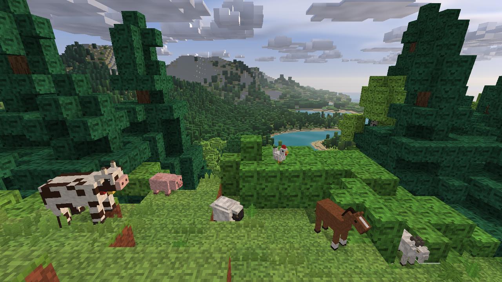 | 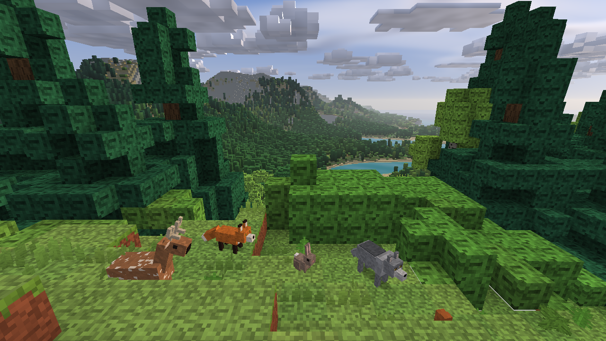 |

| 空の鳥 | 海・川の生き物（モデル一覧） |
|---|---|
| 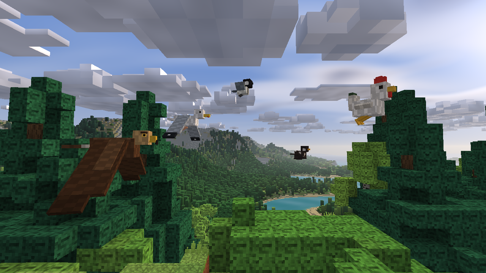 | 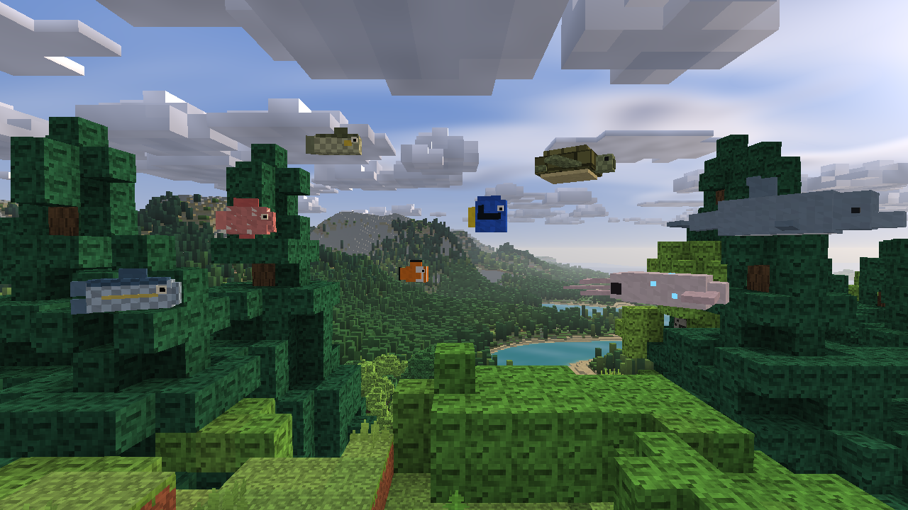 |

| モンスター（モデル一覧） | 夜に現れたモンスター（光る目とランタン） |
|---|---|
| 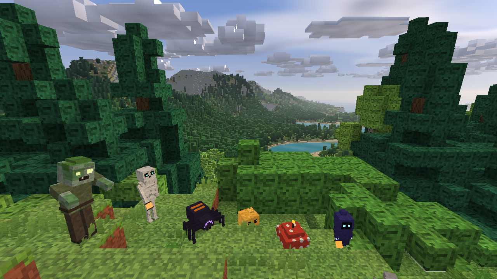 | 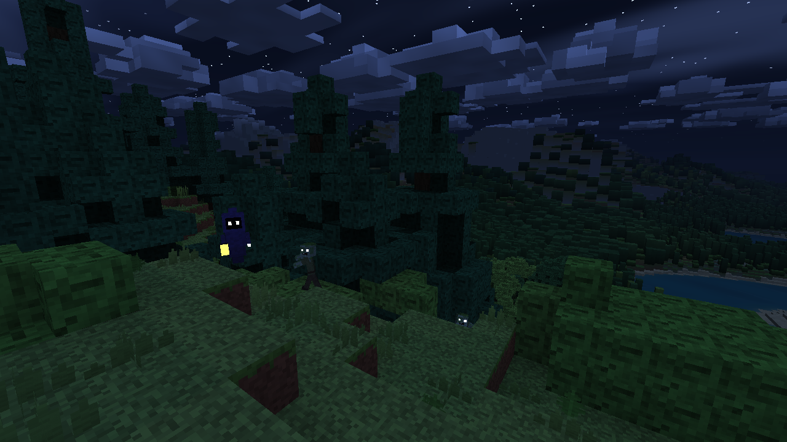 |

| 海の中（群れで泳ぐ魚） | 海辺（イルカのジャンプとカモメ） | スポーンエッグ（iPhone縦） |
|---|---|---|
| 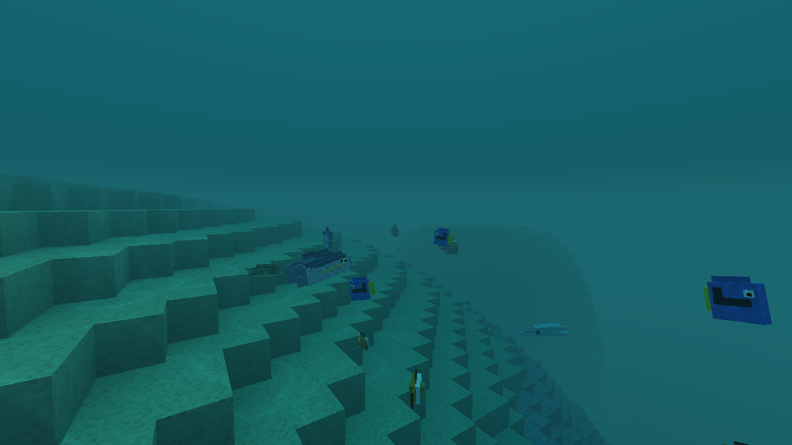 | 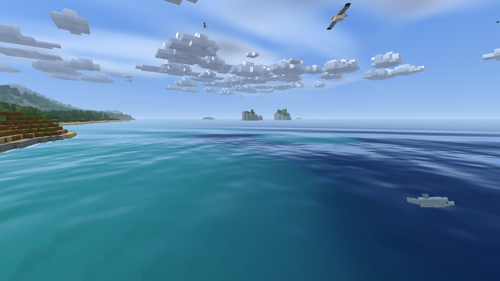 | 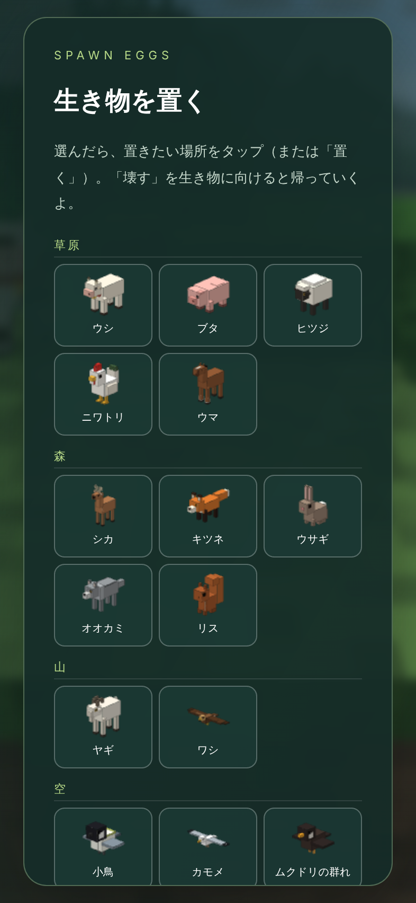 |

既存ワールドにもそのまま生き物が現れる（地形・セーブ形式は互換。セーブに `life` が追加されるだけ）。モード選択・体力・ダメージ・死亡は**実装していない**（自由なサンドボックスのまま）。

- **30種類**：草原（ウシ・ブタ・ヒツジ・ニワトリ・ウマ）、森（シカ・キツネ・ウサギ・オオカミ・リス）、山（ヤギ・ワシ）、空（小鳥・カモメ・ムクドリの群れ）、海・川（アジ・マダイ・アユ・熱帯魚2種・ウミガメ・イルカ・イカ）、モンスター7種（コケゾンビ・スケルトン・オオグモ・コハクスライム・ボムタケ・ヨイトモシ・クラヤミ）。すべて1/16ブロック単位のボクセルモデルで、骨格（最大16本）つき。色違いではなく形から作り分けた（モデル形状が全種で異なることをテストで確認）
- **独自デザインのモンスター**：苔の生えた前かがみのゾンビ（左右で大きさの違う光る目）、ランタンを提げたスケルトン（顎がカタカタ鳴る）、6つの紫の目とオレンジ縞のオオグモ（近づくと前脚を上げて威嚇）、琥珀色のゼリー状スライム（着地でつぶれる）、キノコ型の爆発モンスター「ボムタケ」（膨らんで点滅し、胞子を「ぽふっ」と吹くだけ）、夜だけ現れる灯りの精「ヨイトモシ」（プレイヤーのまわりを漂う）、暗闇の「クラヤミ」（**見ていない間だけ近づき、視線を向けると止まる**）
- **ダメージなし・破壊なし**：モンスターは見る・ついてくる・距離を取る・威嚇するだけ。ボムタケも地形を壊さない（テストでワールドの変更数が増えないことを確認）
- **AI**：歩く・立ち止まる・見回す・草を食む・群れに戻る・逃げる（ウサギ・シカ・キツネ・ニワトリ・リス・魚など）。オオカミは群れで巡回、鳥は旋回・上昇・下降・木や地面に止まる・群れで飛ぶ、魚は群れで泳ぎ水から出ない、イルカは水面近くで時々ジャンプ。崖（2段超の落差）や水には入らず、引っかかったら向きを変えて別の目的地へ
- **自然発生**：プレイヤーから24〜90ブロック、**読み込み済みの地形だけ**に出現（地形を生成させない専用の参照関数）。バイオーム・地面・水深・明るさで種類を選ぶ：草原→牛・羊・馬、森→鹿・狐・兎・栗鼠・狼、山→ヤギ・ワシ、海→魚・イルカ・イカ・ウミガメ、浅い砂地の海→熱帯魚、川→アユ、夜の陸地→モンスター、岩や建物の屋根の下→クラヤミ（将来の洞窟にもそのまま対応）。見えている近い場所には出さない。昼になるとモンスターは煙とともに帰る
- **個体数管理**：画質ごとの上限（低20・標準34・高50）×種類別の割合。FPSが下がると上限を自動で下げ（最大55%減）、余裕が戻ると戻す。遠ざかった・地形がアンロードされた自然個体は消え、オブジェクトプールで再利用
- **スポーンエッグ**：右上の🐾（PCはGキー）で一覧を開く。アイコンは実際のモデルから描画。選ぶと手に卵を持ち、**画面の置きたい場所をタップ**（または「置く」）でその場に出現。スワイプ（見回し）では置かれない。魚は水中、陸の動物は陸だけ。生き物に「壊す」を向けると帰っていく。置いた生き物は世界と一緒に保存（最大80匹）
- **設定**：タイトルとエッグ画面の「生き物：すべて／動物だけ／自然発生OFF」。鳴き声ON/OFF
- **アニメーション**：脚の交互運動（速いとギャロップ）、頭の向き（プレイヤーを目で追う）、待機の揺れ、耳・尻尾、羽ばたきと滑空・止まると翼をたたむ、魚の尾びれ、イルカの尾、イカの噴射、カメのヒレ、スライムの伸び縮み、クモの8本脚の歩行
- **鳴き声**：録音素材を使わず、WebAudioでその場で合成（権利問題なし）。距離で小さくなり、左右に定位。頻度は控えめ
- **最適化**：全種のモデルを1本の静的バッファに入れて共有し、個体ごとにボーン行列（ユニフォーム）だけ送って1ドローで描く。描画距離（低56・標準84・高112）と視錐台カリング、遠い個体はAI更新を間引く（30m以内毎フレーム→100m以上は0.3秒ごと）。毎フレームの割り当てを避けた（GC対策）。影は足元の柔らかい円だけ
- 確認：自然発生のシミュレーションで、草原の昼は牛・兎・小鳥・狼・ムクドリの群れ・リス・シカ・アユ、夜はゾンビ・スライム・クモ・ヨイトモシが出現。iPhoneサイズのタッチ操作（縦・横）でエッグ選択→タップ配置、スワイプでは置かれないことを確認
- 計測：Node上のAI更新は約0.4〜0.5ms/ステップ（約30体）。SwiftShader（CPU描画）は実機GPUと桁が違うため、FPSは参考にならない

**未検証**：iPhone 16 / A16 iPad 実機でのFPS・発熱・音量バランス。重い場合は画質「低」で生き物の上限と描画距離も下がる。`?bench` の結果に生き物の数も出るようにした。

## v11.0 — UNDERGROUND（Phase 11：巨大洞窟・地下世界）

| 山の斜面の洞窟の入口 | 地底湖と天井から差す光 |
|---|---|
| 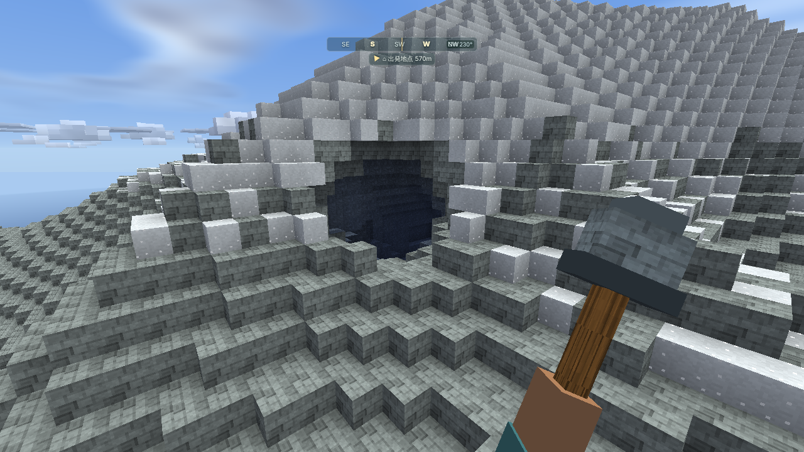 | 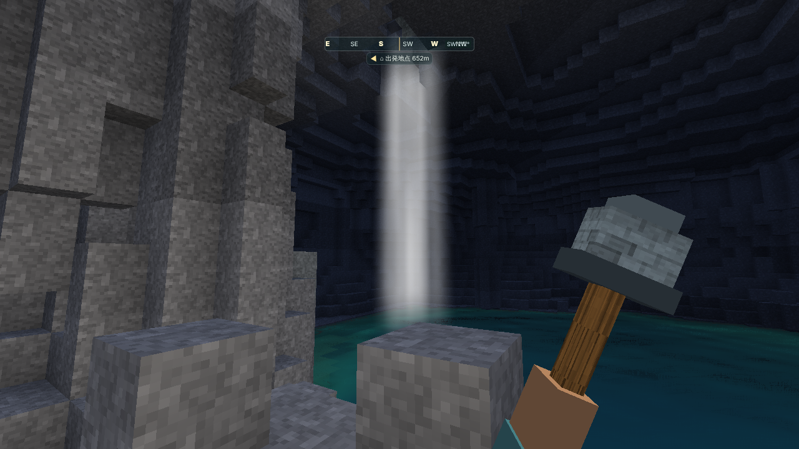 |

| 地底湖を高台から見下ろす | 天然の岩橋がかかる巨大ホール |
|---|---|
| 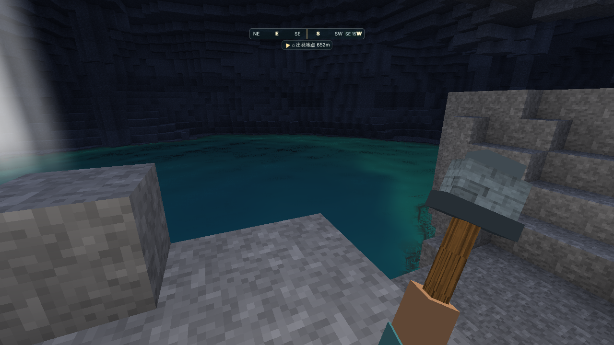 | 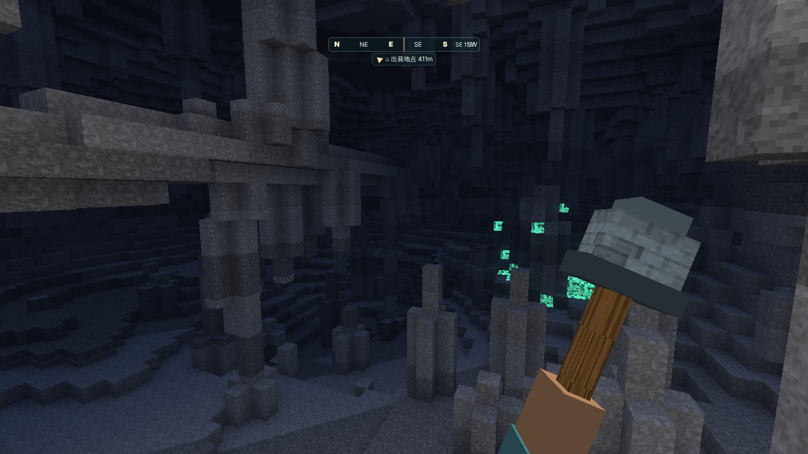 |

| 結晶洞窟（青・紫・翠） | 結晶洞窟の奥 |
|---|---|
| 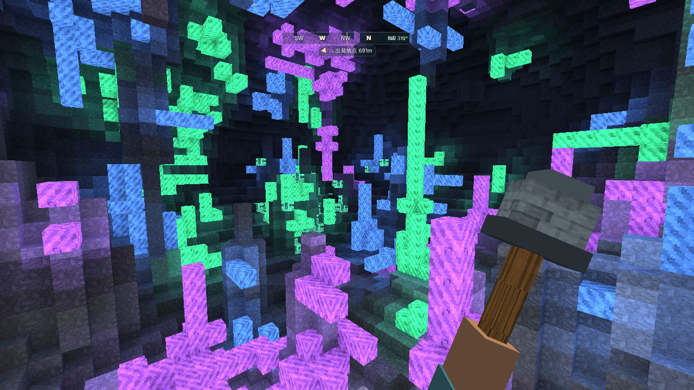 | 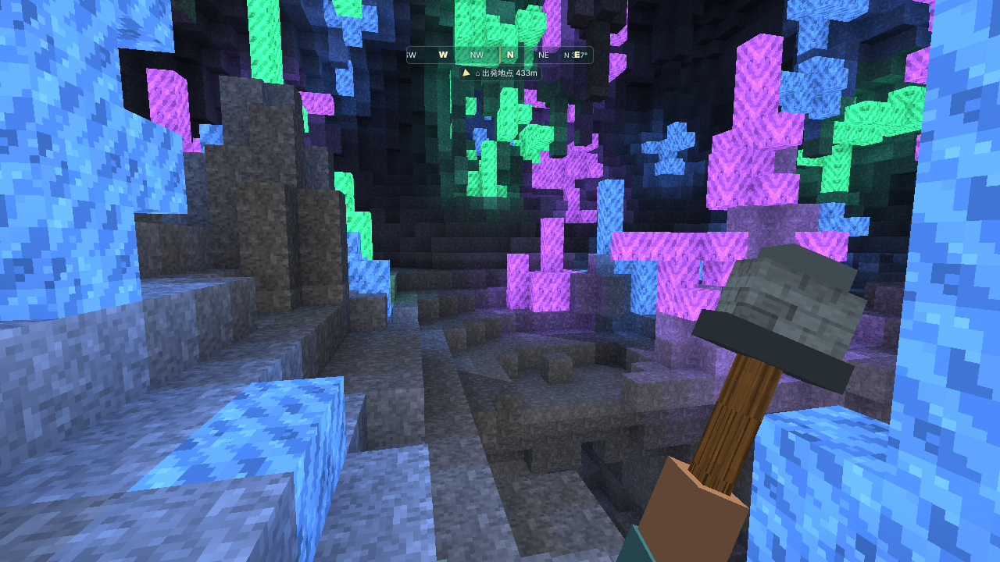 |

**新規ワールド（生成バージョン7）のみ**。v6以前の既存ワールドは洞窟を生成せず、地形・ブロック・近景メッシュ・遠景タイルが従来とビット単位で同一（テストで確認）。サバイバル要素（体力・戦闘・ダメージ）は入れていない。

**探索方法**：山の斜面を歩くと洞窟の口が見つかる。タイトルの「洞窟探検へ」で、入口・巨大空洞・地底湖・結晶洞窟を順に見て回れる（ワールドごとに約10〜20か所）。洞窟の中でも壊す・置く、歩く、飛ぶがそのまま使える。

- **仕組み**：チャンクは元々フル3Dのボクセル配列（16×16×192）なので、メモリを増やさず**生成時に岩をくり抜く**。256ブロック四方の「セル」ごとに、シードだけで決まる洞窟網（部屋・トンネル・縦穴・橋・煙突）を作り、各チャンクは自分に触れる形だけを取り出して彫る。隣のチャンクを見ないので境界で破綻せず、同じシードなら毎回同じ洞窟。
- **入口**：歩いて近づける傾斜（約45°以内）の山腹に、下り坂の口が開く。口は地面の高さに揃い、周囲の木・草は避ける。地表の殻（3ブロック）は入口と煙突を除いて必ず残るので、地表に意図しない穴は開かない（約10万列でテスト）。
- **内部**：長く曲がるトンネル（傾斜は高低差に応じて最大約42°まで）、複数の階層、巨大ホール（幅最大約80・高さ約45ブロック）、地下の段差と崖、縦穴、天然の岩橋、鍾乳石・石筍・柱、側道の小空洞。壁は形ごとにノイズで揺らし、均一な形にならない。トンネルは必ず部屋に繋がり途中で途切れない（全入口で空気だけをたどって部屋に着くことをテスト）。
- **3種類**：①通常の洞窟（灰色の岩肌、暗い通路と大空洞、光ゴケの小さな明かり）②**地底湖**（水面を海面の高さに合わせて、既存の水シェーダーの波・深さ色・岸の泡をそのまま使用。青緑に淡く光る湖面、水際の岩肌、湖を見下ろす高台、天井の煙突から差し込む光の柱）③**結晶洞窟**（青・紫・翠の結晶が大小の群れで生え、周囲の岩を結晶の色で照らす。珍しく、ワールドごとに数か所）。
- **光**：動的ライトは使わない。頂点に3種類の情報を詰めて（既存の頂点形式のまま）シェーダーで合成する：①**暗さ**（面の前の空気の上にある岩の厚み。入口付近は明るく奥ほど暗い）②**結晶・光ゴケの光**（近くの光源から色と強さを焼き込み）③プレイヤーのランタン（足元に暖色の光だまり）。地下では霧が暗い青紫に変わり、遠景・空・雲の描画を止める。
- **スマホ最適化**：①くり抜きの3Dノイズを約10倍速のテーブル参照にして、明らかに内側/外側の部分は計算を省略（1チャンク約35ms→約4ms）②地下では描画範囲を最大4チャンクに縮める（標準で1チャンク分＝描画チャンク約28%減、高で3チャンク分。ロード済みは保持するので出入りで再読込しない）③洞窟の面は壁に面した所だけ生成（約1,800面/チャンク）④洞窟判定は0.2秒ごとの少数の光線のみ。地上のメッシュ化コストは導入前と同等（約2〜4ms/チャンク、ばらつきの範囲）。
- **地下の生き物**：地下にいる間は地表の自然発生を止め、暗い洞窟の床にクラヤミ・クモ・スライム・スケルトンが少数（最大7）だけ現れる。ダメージも地形破壊もなし。「生き物：動物だけ／OFF」では静か。
- **セーブ**：洞窟はシードの純関数なのでセーブに入らない。洞窟内の編集は通常の `changes` に保存され、地上と行き来しても保たれる。新ブロック（26青い結晶・27紫の結晶・28翠の結晶・29光ゴケ）を追加。詳細は `docs/SAVE_SYSTEM.md`。

**検証**（`node check.cjs` 全45項目合格）：v6ワールドの完全一致、洞窟の決定性、地表の穴なし、全入口の接続、湖の水が岩で囲まれていること、結晶の光、鍾乳石・石筍、地下判定、タイトルボタンの安全な着地、洞窟内の歩行・飛行・採掘・保存・再読み込み、セーブ検証、洞窟の生き物。実ブラウザ（Chromium）で全シェーダーのコンパイルとスクショ、iPhoneサイズのタッチ操作（縦・横）も確認。

**未検証**：iPhone 16 / A16 iPad 実機でのFPS・発熱・メモリ。SwiftShader（CPU描画）の数値は実機GPUと桁が違うので載せない。洞窟の多い山で重ければ画質「低」（描画距離と植生が減る）を試して、`?bench` の結果を共有してほしい。

**今後の候補**：地下川・滝、洞窟の天井の水滴や環境音、鉱石、洞窟のコンパス/マップ表示、既存ワールドで洞窟を有効にするオプション（既存の建築の下を掘らない安全策が必要）。

## v16.0 — ADVENTURE（Phase 2：鉱石・宝探し・装備強化・洞窟冒険）

| 洞窟の壁の鉱石（鉄・金・ダイヤ） | 長押しで掘る（ひび割れと進み具合） | 宝箱と「🎁 開ける」 |
|---|---|---|
| 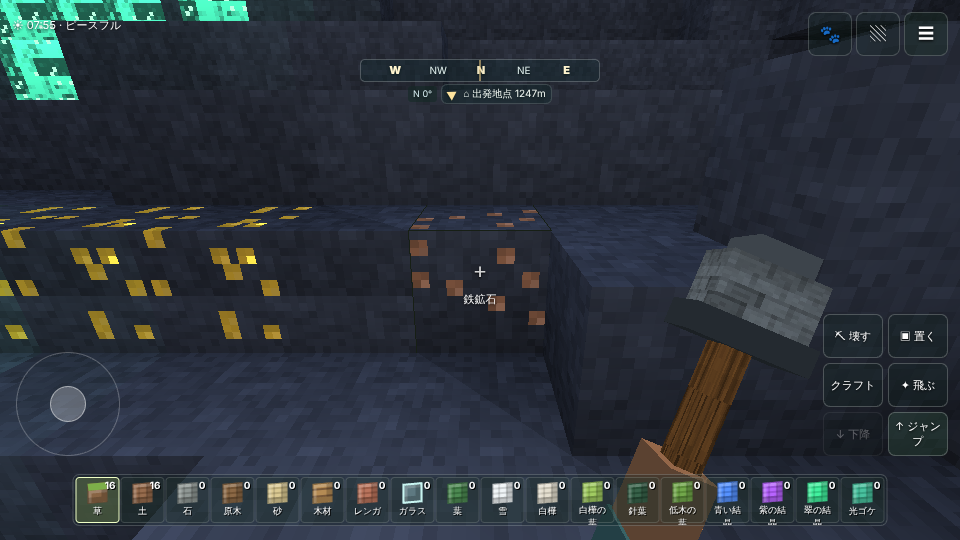 | 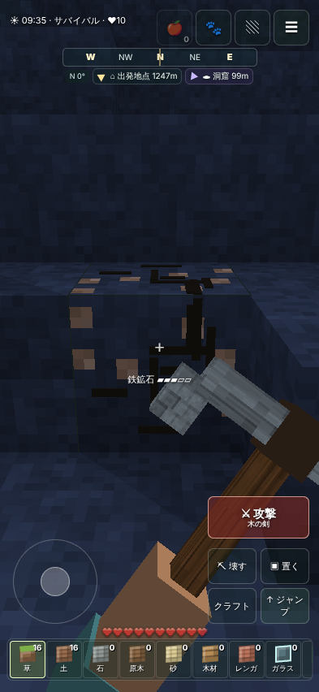 | 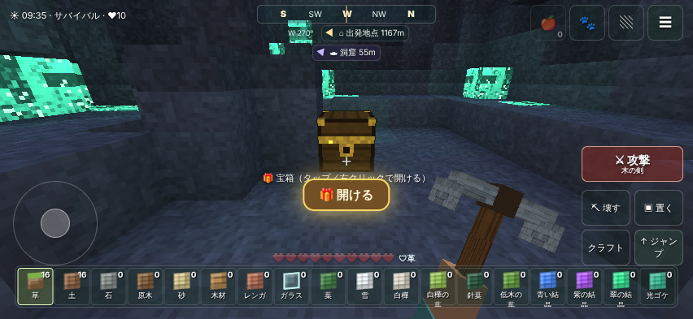 |

| 開けた宝箱と中身・はじめての宝箱 | レアアイテム発見（iPad） | クラフト・持ち物（iPhone縦） |
|---|---|---|
| 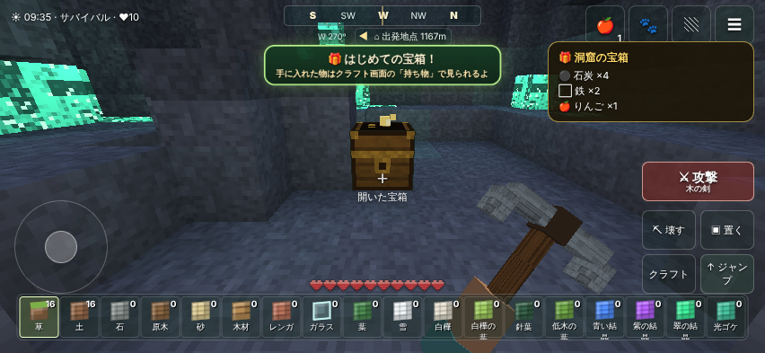 | 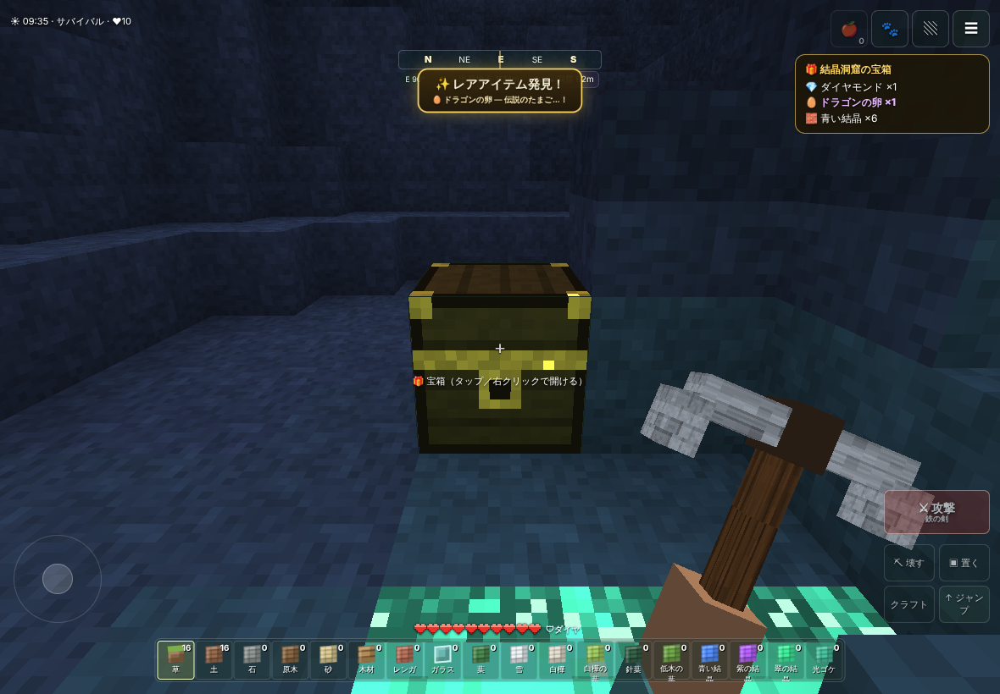 | 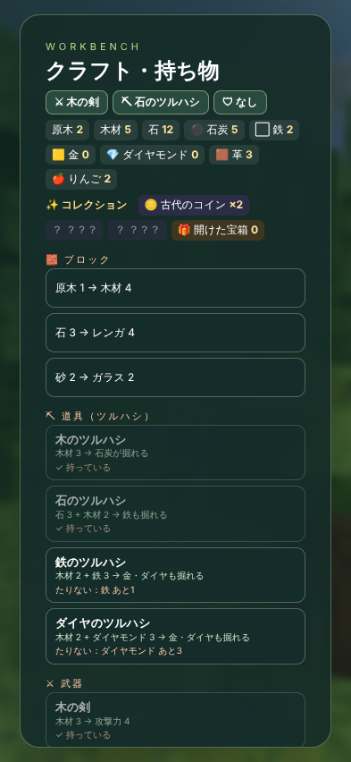 |

| 洞窟グモ・クリスタルスライム（昼の地上で比較） | 結晶洞窟で光るクリスタルスライム | iPhone縦のHUD |
|---|---|---|
| 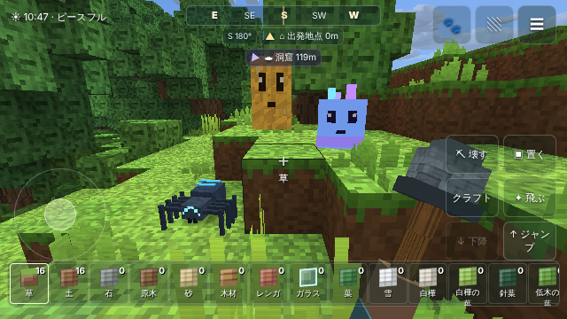 | 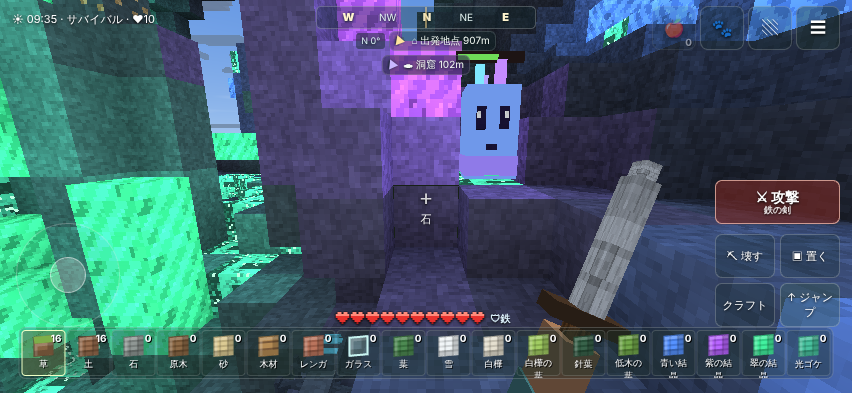 | 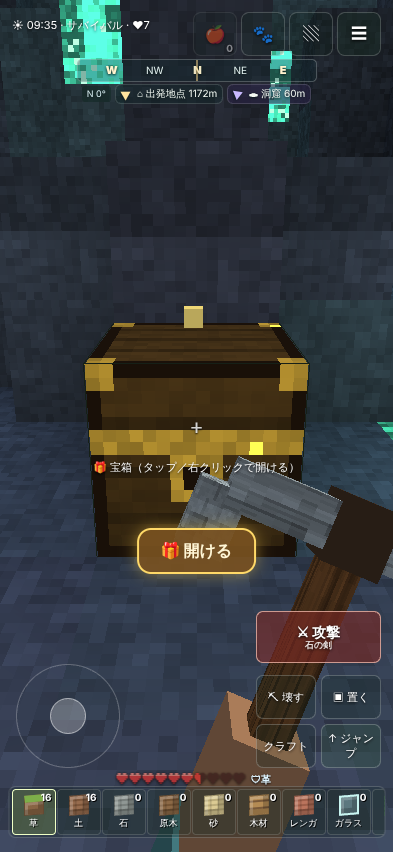 |

**目標**：「木の剣 → 洞窟を見つける → 鉱石を掘る → 鉄の装備 → 洞窟の奥の宝箱 → 珍しいアイテム → 次の洞窟へ」。

- **鉱石（新規ワールド・生成バージョン10）**：石炭（浅い所に多い）・鉄鉱石（中層）・金鉱石（深い）・ダイヤモンド鉱石（最深部・とても珍しい）。複数ブロックの鉱脈で、**石だけを置き換える**ので宙に浮かず、木・水・アーチには出ない。洞窟の壁・床・天井には見つけやすい露出鉱石を追加。シードとチャンクだけで決まる純関数（隣のチャンクを見ない）。見た目は石の模様に色の粒（金・ダイヤは少し光ってキラッと瞬く）。
- **ツルハシ（木・石・鉄・ダイヤ）**：持っている一番良いものを自動で使う（持ち替え不要）。石炭は木以上、鉄は石以上、金・ダイヤは鉄以上。サバイバルでは石と鉱石は「壊す」長押し（PCは左クリック長押し）で掘る：石は素手0.9秒→木0.45→石0.3→鉄0.2→ダイヤ0.13秒。ひび割れ・破片・照準下の「▰▰▱▱」で進み具合が分かる。道具が足りないと「鉄鉱石は『石のツルハシ』以上で掘れるよ」と表示し、照準に🔒。鉱石を壊すと素材（石炭・鉄・金・ダイヤ）が直接手に入る（精錬なし）。**ピースフル・クリエイティブの採掘は従来どおり一瞬**。
- **武器**：木4・石6・**鉄9・ダイヤ12**（ゾンビは木で3発、ダイヤで1発）。**防具**：革（20%カット）・鉄（40%）・ダイヤ（60%）。一番良いものを自動で着る。ハートの横に「🛡鉄」。♥は変化せず、受けるダメージだけ減る（半ハート単位）。革はモンスターが落とす（最初の1体は必ず2個）。死亡・復活しても装備はそのまま。
- **クラフト・持ち物画面**：装備（⚔⛏🛡）、素材の数、レアアイテムのコレクション（未発見は「？？？」）、開けた宝箱の数。各レシピに「つくれる！」「✓持っている」「たりない：鉄 あと2・木材 あと1」を表示。プレイ中の画面にボタンは増やしていない（宝箱の近くだけ「🎁 開ける」が出る）。
- **宝箱**：普通の洞窟・巨大洞窟・結晶洞窟（必ず）・地底湖のほとり・大滝の裏の洞窟・海底アーチの下・海底渓谷。すべての洞窟にあるわけではない（ワールド全体で約70個）。近づくと「🎁 開ける」（タップ）、PCは右クリックかTキー（「壊す」を向けても開く）。開けると効果音・光の粒・右上に中身の一覧。**中身は宝箱の場所と種類で決まる**（読み込み直しても変わらない）。開けた宝箱は「開いた宝箱」ブロックになり普通の変更として保存されるので、**同じ宝箱から二度は取れない**。プレイヤーが置いたブロックが優先され、宝箱は勝手に復活しない。最初の宝箱は鉄を2個以上保証。
- **洞窟限定モンスター（サバイバルのみ）**：**洞窟グモ**（速い・HP8・壁に当たると回り込む・噛みつき）、**クリスタルスライム**（結晶洞窟だけ・青紫に光る・HP16・跳びかかり・金や「不思議な結晶」を落とすことがある）。既存の生き物エンジン・予備動作（白く光る）・出現上限（低2/標準4/高5）をそのまま使用。地上・ピースフルには出ない。
- **レアアイテム**：🪙古代のコイン、🔮不思議な結晶、🥚ドラゴンの卵（結晶洞窟・滝の裏・海底の宝箱からまれに。1ワールドに0〜1個程度）。初めて手に入れると「✨ レアアイテム発見！」と短い効果音（約3.6秒で消え、操作を邪魔しない）。コレクションとして保存（孵化などは次の大型アップデート）。
- **子ども向けの工夫**：持ち物は死んでも失わない（従来どおり）、空腹なし。最初のガイドの後は次の目標を短く表示（木のツルハシ→石のツルハシ→洞窟で鉄→鉄の装備→宝箱→ダイヤ→ドラゴンの卵）。進展がない時は2.5分ごとに再表示。はじめての石炭・鉄・金・ダイヤ・宝箱をお祝い。コンパスに「🕳 洞窟 85m」（200m以内の洞窟の入口）、**地下では「⛰ 出口」**の方向を表示。
- **ついでに直した既存の不具合**：海面より低い乾いた洞窟で、生き物に水中の色の減衰がかかって真っ暗に見えていた。

**セーブ互換**：`version: 1` のまま。新規ワールドは `terrainVersion: 10`。**v9以前のワールドの地形・ブロックは完全に同じ**（同じシードのv9とv10を比べ、違いは「石→鉱石」と「空気/水→宝箱」だけであることをテスト。v7・v9の既存指紋も一致）。既存ワールドには鉱石・宝箱は出ない（保存済みの建築や採掘跡を変えないため）が、道具・武器・防具・洞窟モンスター・目標表示は使える。`items` に装備・素材・コレクション・開けた宝箱の数・初発見フラグを任意フィールドとして追加（旧セーブは0から）。新ブロックID：30石炭鉱石・31鉄鉱石・32金鉱石・33ダイヤ鉱石・34宝箱・35開いた宝箱。v9ワールドで遊んでも新IDは保存されないので、旧リリースでもそのまま開ける（v10ワールドは旧リリースでは「未対応」として保護される）。

**性能（Node・CPUのみ）**：鉱石・宝箱の生成はチャンク生成時の1回だけ（毎フレームの計算なし）。洞窟チャンクの生成時間 v9 27.3ms → v10 27.4ms（壁の鉱石は石に接した空間だけ判定）。鉱石は石と同じマテリアル番号を使い、頂点形式・描画命令は増えない（出発地点5×5チャンクの面数は v9と同じ25,085）。宝箱も通常ブロックとしてチャンクのメッシュに統合。宝箱のキラキラは18ブロック以内の粒だけ。洞窟モンスターは既存の上限内。森林・水面・雲・珊瑚礁・滝は変更なし。

**検証**：`node check.cjs` 全項目合格（追加：全鉱石の生成と高度・希少性、石だけを置き換えること、宝箱は床の上、決定性、ツルハシ段階、長押し採掘、素材入手、ピースフル/クリエイティブ、不足素材の表示、武器と防具、♥不変、死亡後の装備、宝箱の発見・開封・二度取れない・再読み込み後も・建築優先、戦利品の希少性、レアアイテムの保存、洞窟グモ・クリスタルスライムの行動と撃破・地上やピースフルに出ない、目標表示、洞窟コンパス）。Chromium（SwiftShader）で全シェーダーのコンパイル、iPhone横（852×393）・縦（393×852）・iPad（1180×820）でボタン・ハート・ホットバー・宝箱ボタン・発見表示が重ならないことを確認。

**未検証**：iPhone 16 / A16 iPad 実機でのFPS・発熱・長押し採掘の押しやすさ・効果音の音量。Safari実機。実際に子どもが遊んだときのバランス（5分/15分/30分の目安）。

## v15.0 — SURVIVAL（サバイバル Phase 1：体力・戦闘・モンスター）

| 夜の戦闘（ゾンビ・スライム・スケルトン、HPバー） | 被弾（赤い縁取り・ハート） |
|---|---|
| 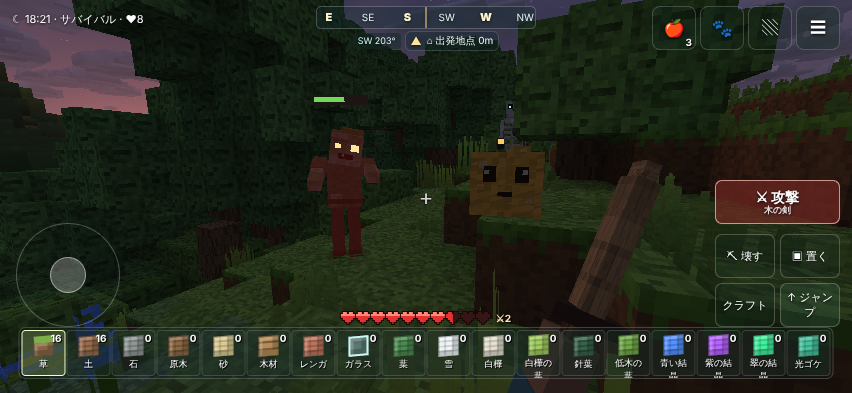 | 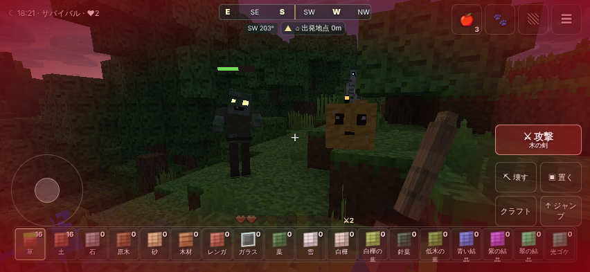 |

| 遊び方の選択 | 復活画面 | iPhone縦 |
|---|---|---|
| 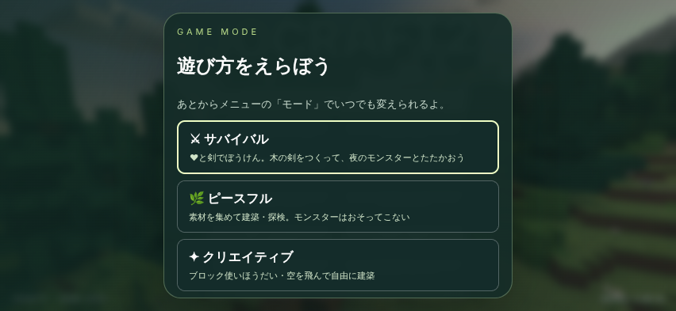 | 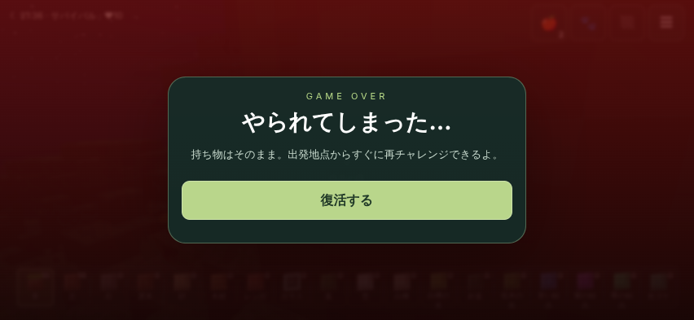 | 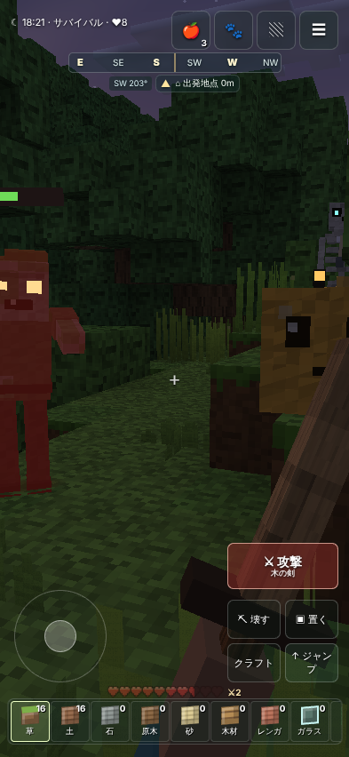 |

**目標**：「5分で木の剣をつくり、夜のモンスターと戦って、倒す」。新しいサバイバルの世界は昼過ぎから始まり、約5分で最初の夜になる。

- **3つのモード**：サバイバル（♥・剣・夜の敵）／ピースフル（素材集め・建築。モンスターは襲ってこない＝従来の「素材集め」）／クリエイティブ（使いほうだい・飛行＝従来の「自由建築」）。新しい世界では最初の「シングルプレイ」で選ぶ。タイトルの「モード」ボタンでいつでも切り替え可能（サバイバルに入ると着地し、3秒の保護つき）。**既存セーブは従来の遊び方のまま**（自由建築→クリエイティブ、素材集め→ピースフル）で、サバイバルに強制変更しない
- **体力**：最大20（ハート10個、ホットバーの上）。被弾で赤い縁取り・小さなのけぞり・効果音、0.8秒の無敵時間。♥3つ以下で心臓の鼓動表示。静かに10秒過ごすと少しずつ自然回復
- **死亡と復活**：「やられてしまった…」画面 →「復活する」で出発地点へ。**持ち物は失わない**。復活後5秒は無敵、出発地点付近の敵は消える
- **回復アイテム**：りんご🍎（♥+3）。葉っぱ4つでクラフト、葉を壊すと時々手に入る、敵を倒すと時々落とす。右上の🍎ボタン（PCはRキー）で食べる
- **剣**：木の剣（木材3・攻撃力4）、石の剣（石3＋木材1・攻撃力6）。持っている一番強い剣を自動で装備（持ち替え不要）。鉄の剣はデータだけ用意（鉄の素材が入ったら有効化できる）。原木1つ→木材4→木の剣なので、開始から数分で作れる
- **攻撃**：右側の大きな「⚔ 攻撃」ボタン（押しっぱなしで連続攻撃）。PCは左クリック。照準の先に敵がいれば「壊す」も攻撃になり、後ろのブロックを壊さない。近距離はタッチ向けの小さな照準補助。攻撃間隔0.45秒、軽いノックバックとひるみ、命中で赤く光ってHPバー表示、撃破で効果音と光の粒
- **モンスター（既存の生き物システムを再利用）**
  - コケゾンビ：夜の草原・森に出現。見つけると遅めに追いかけ、腕を振り上げて（白く光る予備動作）たたく
  - スケルトン：夜や洞窟に出現。距離を保って横に動き、弓を引いて（予備動作）放物線の矢を撃つ。矢は地形に刺さって止まる・よけられる。モデルに弓を追加
  - コハクスライム：草原・洞窟に出現。跳ねながら近づき、しゃがんで（予備動作）体当たり
  - 3体とも：プレイヤーが見えている間だけ戦う（ブロック越しの視線・攻撃・矢はなし）。壁は通れず段差は1段まで。32ブロックより遠いと戦わず、64ブロック以上離れると消える。朝になると帰る（洞窟の中は残る）
  - サバイバル中、他のモンスター（クモ・ボムタケ・ヨイトモシ・クラヤミ）は自然発生しない。ピースフル・クリエイティブでは従来どおり無害な生き物として出る
- **子ども向けの調整**：夜になって8秒後に1体、その後20秒ごとに1体ずつ増える。モンスターを3体倒すまでは同時2体まで・被ダメージ約2/3。**出発地点の半径24ブロックは安全地帯**（敵は出現せず、入らず、中にいる間は攻撃しない）。予備動作中に先に当てると攻撃を止められる。最初だけ「木を集める→剣をつくる→安全地帯の外へ冒険しよう（夜になるとモンスターが出る）→戦う→回復」の短いガイド（端末ごとに1回・タッチを通すので視点スワイプの邪魔にならず、15秒で自然に消える）
- **生き物の設定との関係**：サバイバルでモンスターが出るのは「生き物：すべて」のときだけ。新しい世界ではこれが標準。既存の世界で「動物だけ／自然発生OFF」にしていた場合は**黙って変更せず**、タイトルの「生き物」ボタンに「⚠敵なし」を表示し、プレイ開始時・モード切替時・設定変更時・ステータス行（「敵なし」）で理由と直し方を案内する。OFFにした設定は尊重し、モンスターは出ない
- **スマホ**：サバイバル中は「飛ぶ／下降」を隠して、その場所に横長の攻撃ボタンを配置。iPhone横・縦・iPadサイズで、ボタン・ハート・ホットバー・スティック・コンパス・ガイドが重ならないことをブラウザで確認
- **iPhone向けの最適化**：同時出現の上限（低2・標準4・高5、FPS低下時はさらに減らす）。視線判定は0.25秒ごと、矢は最大12本。既存のAI間引き（遠いほど更新間隔を長く）をそのまま利用。HPバーは攻撃した敵だけ4秒間。画質「低」では撃破エフェクトの粒を半分に。景観（地形・LOD・雲・水・描画距離）は削っていない
- **ついでに直した既存の不具合**：①ホットバー9番目以降（葉・雪など）を選ぶと保存が毎回失敗していた ②昼の動物で上限が埋まると夜にモンスターが出ないことがあった（回帰テストが約50%で失敗していた）

**セーブ**：`version: 1`・地形バージョン（新規は9のまま）は変更なし。`gameMode`・`health`・`items`・`defeated`・`settings.hotbar` を任意フィールドとして追加。`creative` を同期して保存するので旧リリースでも開ける。詳細は `docs/SAVE_SYSTEM.md`。

**検証**：`node check.cjs` 全項目合格（サバイバルの回帰テストを追加：モード選択・旧セーブの対応・ハート・ゾンビの追跡と予備動作と攻撃・壁越し攻撃なし・スケルトンの矢と地形での停止・スライムの体当たり・剣3回でゾンビ撃破・ノックバック・死亡と復活・安全地帯・回復・クラフト・夜の出現と上限と朝の退場・保存と再読み込み・旧リリース互換・攻撃ボタンの押しっぱなし）。Chromium（SwiftShader）で全シェーダーのコンパイル、iPhone横（852×393）・縦（393×852）・iPad（1180×820）でのタッチ攻撃とレイアウト、コンソールエラーなしを確認。

**未検証**：iPhone 16 / A16 iPad 実機でのFPS・発熱・タッチの押しやすさ・効果音の音量バランス。Safari実機での `:has()` によるHUD切り替え（iOS 15.4以降対応）。

## v14.0 — GRAND NATURE（絶景 Phase 1：大滝・大渓谷・天然アーチ・海底地形）

| 大瀑布（落差76m・滝壺に虹） | 珊瑚礁の丘 | 海食アーチ |
|---|---|---|
| 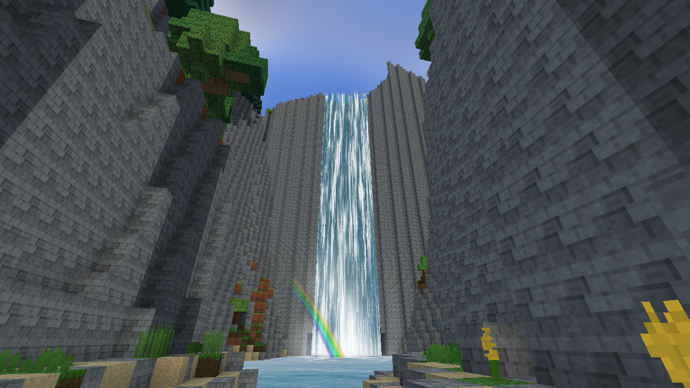 | 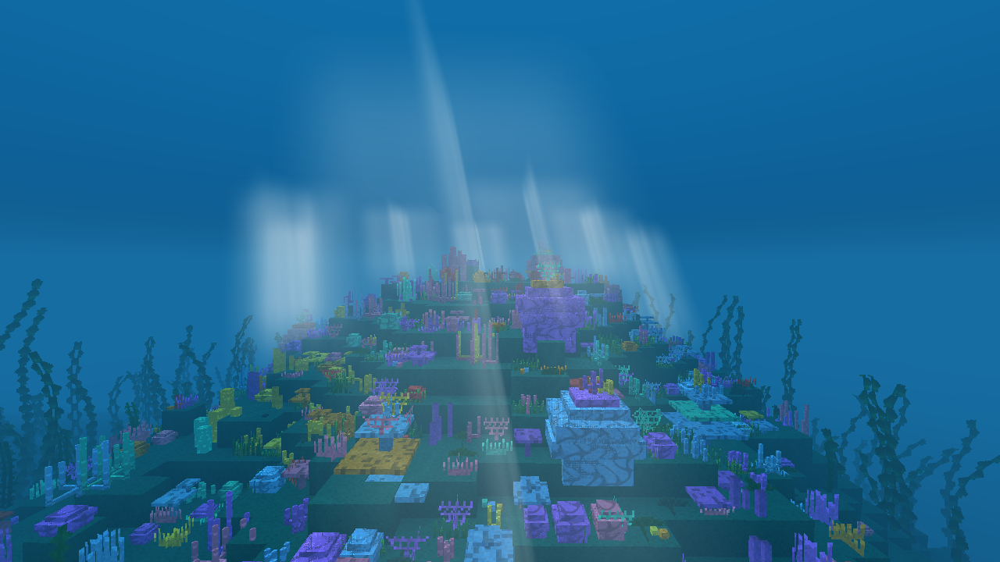 | 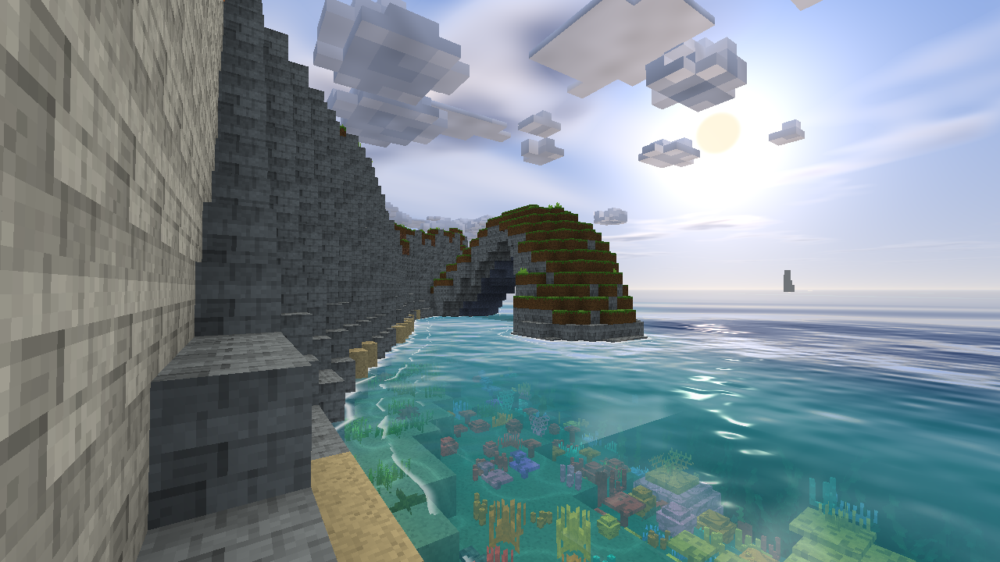 |

| 大渓谷（上空から） | 遠くから見た大瀑布（遠景LOD） | 滝の裏の洞窟 |
|---|---|---|
| 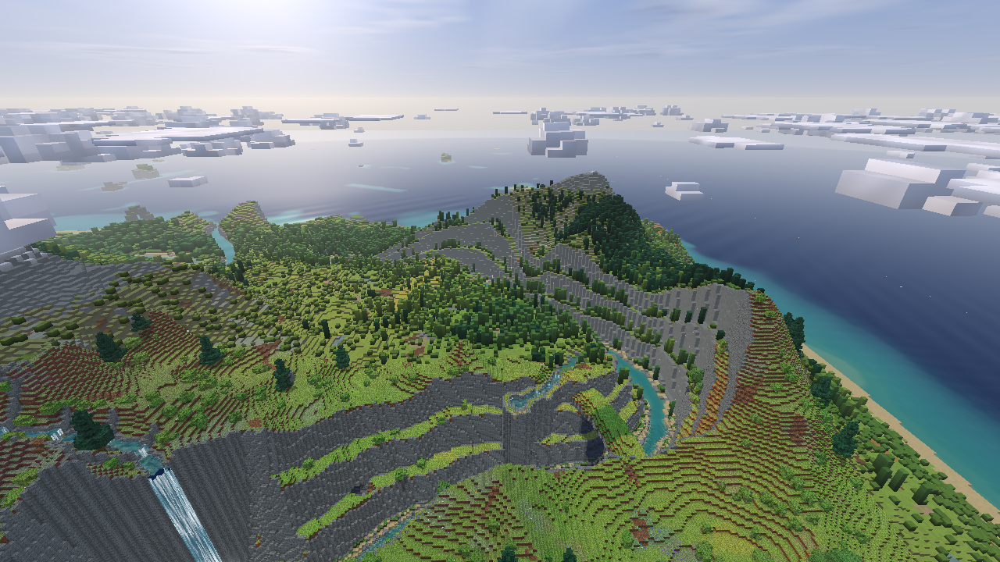 | 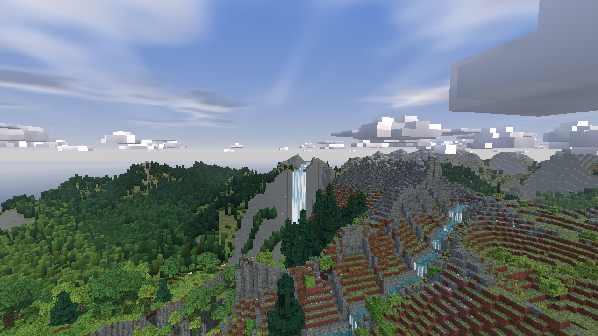 | 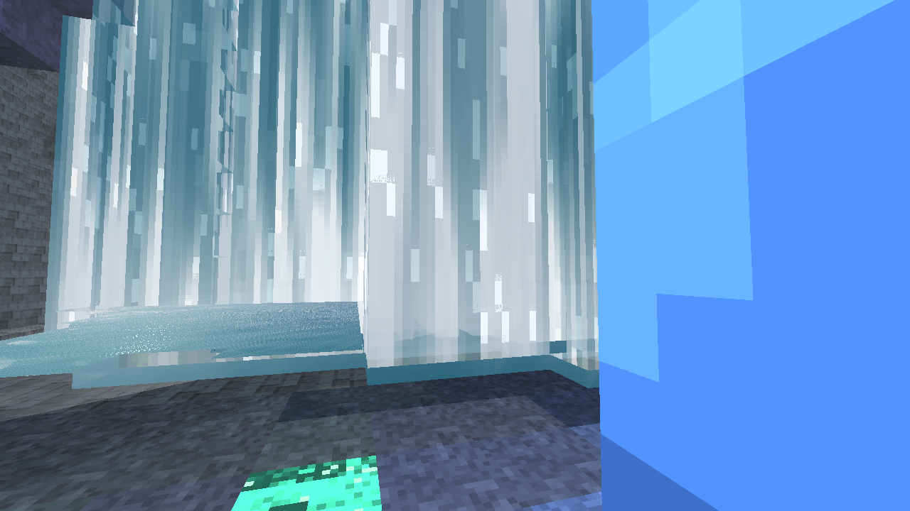 |

| 大渓谷の縁から（絶景スポット） | 天然アーチ | 海底アーチ |
|---|---|---|
| 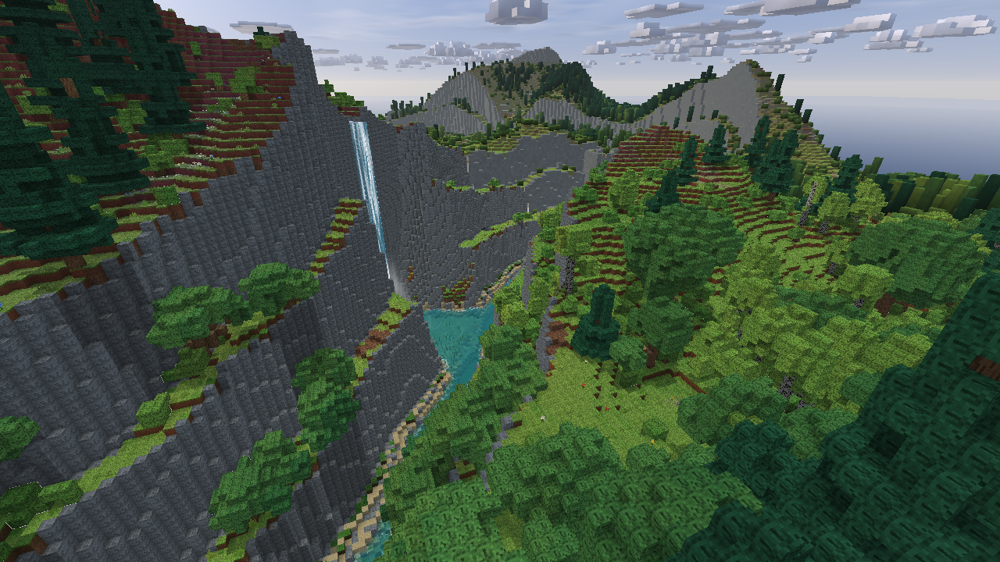 | 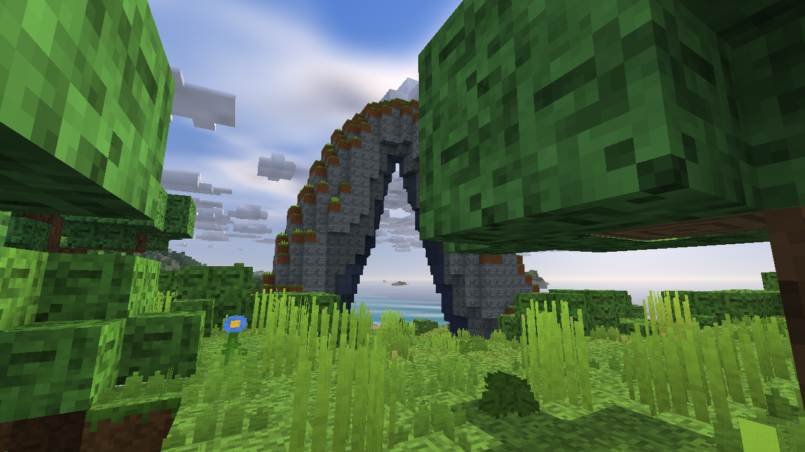 | 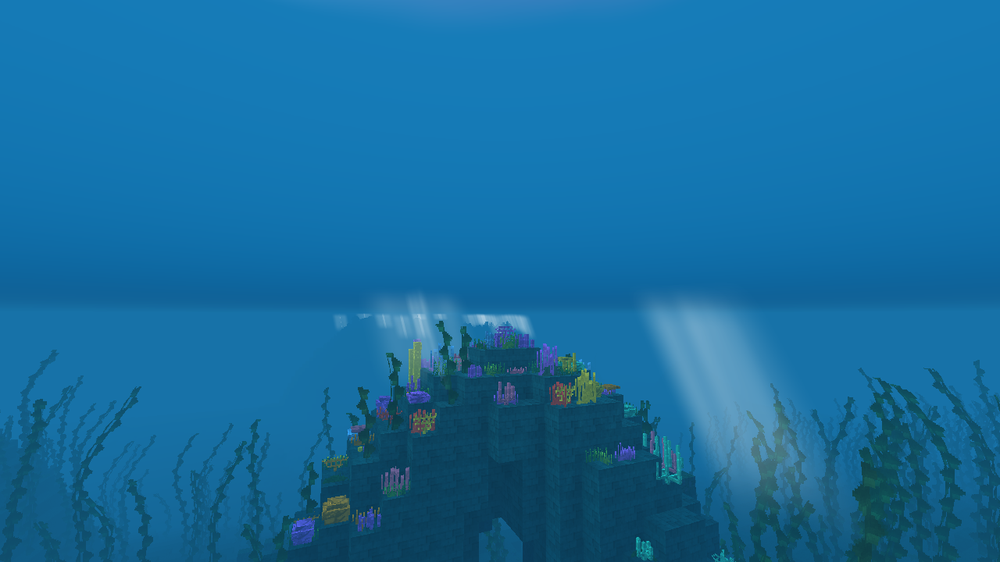 |

| 変更前（v8）→ 変更後（v9）：同じシード・同じ位置・同じ向き |
|---|
| 上空 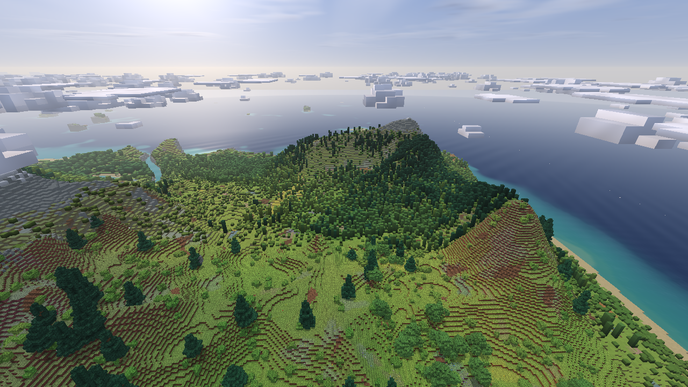  |
| 遠くの山 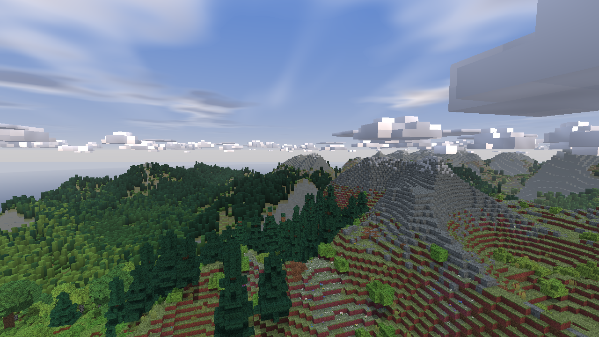  |

**新規ワールド（生成バージョン9）のみ**。v8以前のワールドは地形・ブロック・近景メッシュ・遠景タイル・出発地点まで従来と完全一致（テストで確認）。「新しい世界」を押すとv9の世界になる。

- **大渓谷**（1ワールドに1〜3本）：高地から海へ向かって蛇行しながら下る、長さ300〜750m・深さ70〜100mの谷。谷底は海面の高さの川と、明るい草地・砂利の河原。壁は垂直に近い段（2〜3段）と岩棚（棚には低木）、壁の位置は少しずつ揺らぎ、細い峡谷と広い谷が交互に現れる。上流端は円形の谷頭。谷底は森が濃く、崖の上は草原（見晴らしを優先）
- **滝**（1ワールドに5〜8本、落差20〜60m、まれに60m超の「大瀑布」）：渓谷の谷頭・渓谷の側壁・高い海食崖に生成。上流は小さな段々の池が連なる沢（各段は平らな水面で、段の間に小さな滝）、縁から厚さ2ブロックの水のカーテンが滝壺に落ち、滝壺は切れ込みを通って渓谷の川または海へ続く。滝の切れ込みの壁はギザギザの岩棚になって後退する
  - 水の描画：海面より上の垂直な水面は「落ちる水」として描く（速さの違う縦の筋が流れ落ち、足元ほど白く、光る飛沫）。滝壺には水煙のカーテン3枚と、広がる波紋・泡。沢の水面は滝に向かって流れる。流体シミュレーションは無し
  - **虹**：太陽を背にしたとき、水煙の中の「太陽と反対の点から40〜42°」の位置にだけ虹色が出る（内側が紫、外側が赤）。朝夕の低い太陽ほど大きく見え、夜・太陽が高すぎるときは出ない
  - **滝の裏**：落差の大きい一部の滝には、滝の裏にドーム状の小部屋がある（滝のカーテンを泳いで抜ける）。中は青い結晶と光ゴケ（既存の洞窟ブロック・照明を利用）
- **天然アーチ・奇岩**：山麓の大きな天然アーチ（1〜2個、大きいものは高さ30〜40m・幅50m前後）、主渓谷をまたぐ天然の石橋、海岸の海食アーチ、風穴の開いた奇岩の塔（2〜4本）。どれも左右非対称（脚の太さ・傾き・横への反り・頂部の位置が違う）で、3Dノイズで岩肌が荒れている。頂部だけ草が生え、周りの森は少し開けて遠くから見える。アーチの下は歩いて（海では泳いで）通れる
- **海底地形**：珊瑚礁の丘（水深15〜20mから海面下4〜5mまで盛り上がり、頂上はピンク・紫・青・シアン・黄色の珊瑚と光の筋）、海底アーチ（魚がくぐれる岩の門、周りに珊瑚）、海底渓谷（大陸棚に沿って蛇行する水中の谷。谷底は海草の草原、壁に昆布、珍しい魚リュウグウノツカイが出やすい）、海底の崖（浅い棚が急に深くなる壁）。普通の砂地はそのまま残し、突然現れる配置
- **希少性と間隔**：小さな絶景は見つけやすく、大瀑布・大アーチは1ワールドに0〜1個。絶景同士は一定距離離して配置
- **見つける楽しさ**：絶景に初めて近づくと（海底の絶景は潜ったとき）「✨ 絶景を発見：大滝（落差52m）（3/31）」と表示（端末にシードごとに記録。セーブ形式は不変）。タイトルの「絶景スポットへ」は従来の12か所（順番も同じ）の後ろに新しい絶景を追加。訪問時は見通しの良い立ち位置を自動で選ぶ（滝は下流から、渓谷は縁から川の方向、奇岩は風穴を通して、海底は泳ぎながら）
- **近景と遠景の一致**：渓谷・滝・沢・海底地形はすべて `height4` の中で適用するので、近景チャンク・遠景LOD・LOD Workerが同じ地形を使う。滝のカーテンは遠景では専用の1枚板（流れる筋つき）、天然アーチと奇岩は同じ岩の判定から作る粗いブロックメッシュ（2〜4ブロック単位）なので、遠くから見えたアーチの穴が近づいても消えない（逆も同じ）

**性能（Node上の計測、実機ではない）**：起動時の絶景配置 約0.1秒（1回のみ）。チャンク生成・メッシュ・遠景タイル・`height4` の時間はv8と同等（誤差の範囲）。滝のある地域では半透明の水の面が100チャンクあたり約4千枚増える（滝のカーテン）。水煙・波紋は近景チャンクのメッシュだけで、低画質では薄くし、虹は全画質で同じ計算（数命令）。毎フレームの地形計算は無し。LOD Workerのソースは約20KB増える

**未検証**：iPhone 16 / A16 iPad 実機でのFPS、滝の前での描画負荷（半透明の重なり）、Safariでの虹・水煙の見え方。スクリーンショットはSwiftShader（ソフトウェアGL）で撮影。

## v13.2 — 大きな珊瑚の塊（ボミー）

| 変更前 | 変更後：礁の中心部に1〜2.4ブロックの大きな塊が立つ |
|---|---|
| 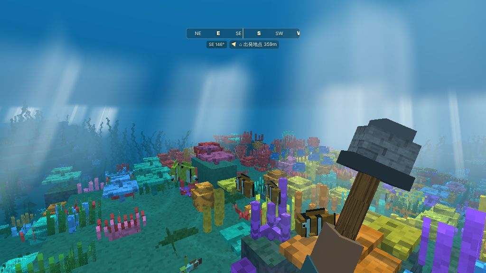 |  |

| 上から見た礁（塊が目印になる） | 塊のまわりの魚 |
|---|---|
|  |  |

- 礁の中心部（水深3〜13）に、**5×5ブロックごとに最大1つ**、高さ1〜2.4ブロックの大きな珊瑚の塊を置く。形は4種類：
  - **脳珊瑚のドーム**：溝模様の厚い板を5段重ねた丸い塊。上に小さな珊瑚や扇が乗る
  - **テーブルの段重ね**：太い幹に大きな板が3段
  - **柱状の珊瑚**：太い柱が5〜8本集まった群生
  - **大きな枝珊瑚の茂み**：大きなミドリイシ風の枝珊瑚が3つ
- 塊の足元の3×3列には小さな装飾を出さない（重ならない）。塊は半ブロック床に沈めて置くので、段差でも隙間が見えない。
- 塊は**全画質で同じ**（礁の目印なので低画質でも消さない）。小さな装飾を置き換える形なので、面数は増えない（礁の中心部 13×13チャンク：138,809 → 138,665）。
- 見た目だけの装飾（セーブ・地形・ブロック変更なし）。プレイヤーや魚は塊をすり抜ける（ほかの珊瑚と同じ）。
- 検証：`node check.cjs` 全49項目合格（塊が礁の中心部にだけ出る・1ブロックより高い・足元が重ならないテストを追加）。実機FPSは未検証。

## v13.1 — 明るい浅瀬と光の筋（珊瑚礁の見せ場づくり）

| 変更前：青緑に濁った水 | 変更後：明るい青・遠くまで澄んで、光の筋が差す |
|---|---|
|  |  |

| 礁の中から見た光の筋 | 見上げた光の筋 |
|---|---|
|  |  |

- **浅い水の色と透明度**：浅い水中の色を青緑から明るいアズールブルーに変え、霧の濃さを約0.045→0.03に下げた（約1.5倍遠くまで見える）。深くなると従来どおり暗い青に変わる。背景色（JS側）と水中シェーダの色を揃え、水平線に色の帯が出ないようにした。川や湖の浅い所も同じ色になる。
- **光の筋**：礁の中心部の上に、水面から海底まで斜めに差す青白い柱（8×8ブロックの区画に最大1本、1チャンクで最大4本×交差2面）。昼だけ見え、夜は消える。標準・高画質のみ（低画質は出さない）。洞窟の天窓の光の柱と同じ描画の仕組みで、追加の描画呼び出しはない。
- セーブ・地形・ブロックは変更なし（見た目だけ）。検証：`node check.cjs` 全49項目合格（光の筋が礁にだけ出る・低画質で出ない・水面で止まるテストを追加）。実機FPSは未検証。

## v13.0 — CORAL REEF（水中景観 Phase 2：珊瑚礁の絶景スポット）

| 珊瑚礁の「当たりスポット」（密集した中心部） | 中に入ると：枝・塊・テーブル・指・小型珊瑚と熱帯魚 |
|---|---|
|  |  |

| カクレクマノミ・ソラスズメダイ・チョウチョウウオ・ナンヨウハギ・ハタタテハゼ | 礁の外周：少しの珊瑚と海藻 |
|---|---|
|  |  |

| 低画質でも礁の見せ場はそのまま（遠くと隙間埋めを間引く） | 水面越しに見下ろした珊瑚礁 |
|---|---|
|  |  |

浅い海に、色鮮やかな珊瑚礁の**ホットスポット**を点在させた。海全体を飾るのではなく、普通の海底 → 少し珊瑚のある外周 → 礁 → 密集した中心部、と強弱をつけて「見つけたら嬉しい場所」にしている。

### 生成場所
- 水深およそ1.2〜16ブロックの海（浅いほど濃く、深いと減る）。広い「礁の海域」ノイズ（約260ブロック周期）× 小さな「ホットスポット」ノイズ（約46ブロック周期）の積で決まる。
- 浅い海（水深3〜9）のうち：中心部 約7% / 礁 約10% / 外周 約28% / 普通の海底 約55%（既定シード）。
- 珊瑚と魚は同じ `reefZone` を使うので、魚も礁に集まる。
- 礁の外にも、岩が転がる「岩場」、海藻の多い静かな深場（既存のケルプの森）、海草の草地がある。

### 珊瑚（形5系統・9種類 × 色7系統）
- **枝状**：交差板の枝珊瑚、中心部では立体の「ミドリイシ風」枝珊瑚（幹＋腕＋上へ伸びる枝先）
- **丸い塊状**：3段の脳珊瑚（溝模様）
- **テーブル状**：短い幹の上の板。ときどき2段
- **指状**：4〜7本の細い指が密集。先端ほど明るい
- **小型カラフル**：ウミウチワ（レース状の扇）、ソフトコーラル（先端の明るい触手）、小さなボタン珊瑚
- （既存のチューブ珊瑚も残る）
- 色：黄・橙・赤・ピンク・紫・水色・青緑。8ブロック四方ごとに「色の系統」があり、近くは似た色（色相環の隣）が寄り、ときどき別の色が混ざる。
- 岩場（石の底や岩の多い場所）では枝状・指状が増え、砂地では塊・テーブル・小型が増える。
- 礁の中心部には**礁の岩**（ピンクの石灰藻と緑の藻が付いた岩）があり、その上にも珊瑚が育つ。中心部では珊瑚の間に小さな珊瑚・海草も入り、地面が空かない。
- 水中で赤から色が失われる表現はそのままに、**珊瑚だけ色の失われ方を弱く**し、彩度を少し上げた（蛍光色にはしない）。そのため水中で遠くからでも「色のある場所」が分かる。

### 魚（14種、うち新規5種）
- **カクレクマノミ**（2〜4匹、礁の中心部から離れない）、**ソラスズメダイ**（青い小魚の群れ10〜16匹）、**チョウチョウウオ**（黄色のペア）、**ナンヨウハギ**（青い中型、2〜5匹）、**ハタタテハゼ**（底付近の小さな魚）。既存のキンギョハナダイ・アオブダイも礁に出る。
- 新しい遊泳層「low」：珊瑚のすぐ上（底から0.4〜2ブロック）を泳ぐ。種ごとに行動範囲（roam）がある。
- 礁のセルは**2つ目の群れ**を持てる。普通の海は群れの出現率を少し下げた（0.36 → 0.30）ので、礁に入ると急に賑やかになる。
- 魚のセルは4つの候補地点のうち礁の上の点を優先する（礁に群れが寄る）。

### スマホ向けの対策
- 珊瑚・岩はすべて**チャンクのメッシュに統合**（追加の描画呼び出しなし）。生成はシードと座標のハッシュで決まり、毎フレームの生成はゼロ。
- 低画質・遠いチャンクでは装飾を決まった割合で間引く（低画質は標準の部分集合）。揺れる珊瑚（扇・ソフトコーラル）は遠くで頂点シェーダが間引く。
- 魚は従来どおりプレイヤー付近のセルだけ。上限を少し上げた：低 34匹/8群・標準 76匹/15群・高 116匹/22群（遠い群れはAIを止め、描画しない）。
- 計測（Node上のメッシュ生成、13×13チャンク）：礁の中心部の不透明面 108,931 → 138,809（+27%）、陸の景色（出発地点）は変化なし（273,124）。礁の中でも陸の景色より面数は少ない。

### セーブ互換
- セーブ形式・ブロック・地形・`terrainVersion` は変更なし。珊瑚と岩はメッシュだけの装飾、魚は実行時だけの存在。
- 水中生態系のある生成バージョン7・8のワールドでは、**今のワールドの海にもそのまま珊瑚礁が現れる**（地形は変わらない）。v6以前のワールドは従来どおり。
- 地上の景色（出発地点）の近景メッシュは面数・内容とも変化なし。v7ワールドの近景の地形メッシュはmainと完全一致（テストで確認）。
- 検証：`node check.cjs` 全49項目合格（珊瑚礁の項目を追加：強弱の段階、中心部の形と7色、低画質の部分集合、礁に魚が集まる、2つ目の群れ、再訪で同じ群れ）。実機（iPhone 16 / A16 iPad / Safari）のFPSは**未検証**。

## v12.1 — 乾いた川底の修正（生成バージョン8）

| 修正前（v7）：森に隠れた乾いた砂の川底 | 修正後（v8）：水が入り、水草が生える |
|---|---|
|  |  |

川の水はすべて海面の高さに張られる。川の強さ（川マスク）が弱い区間では川底が海面のすぐ上で止まり、**水のない砂の谷**になっていた（海面近くの川の中心線の約13%）。v8では、海面に近い川底だけを川幅の中で滑らかに掘り下げて水を入れる。標高の高い谷を上っていく川は今まで通り（水はどこかで終わる必要があるので、川の終わりに数ブロックだけ乾いた所は残る）。

- **新規ワールドだけ**（生成バージョン8）。既存のv7以前のワールドは地形・ブロック・近景メッシュ・遠景タイルが完全一致（テストで確認）。セーブ形式は変更なし。
- 乾いた砂の川底（海面〜+2、川の中心線）：既定シードで 463 → 62 か所（約87%減）。水のある川の中心線は 3,031 → 3,674。
- 遠景ワーカーも同じ地形関数を使うので、近景と遠景の川は一致する。
- 直った川には水中生態系（水草・メダカ・コイなど）がそのまま現れる。
- 検証：`node check.cjs` 全48項目合格（v7の完全一致と、v8で乾いた川底が減ることを追加）。実機は未検証。

## v12.0 — WATER LIFE（水中生態系 Phase 1：水草・魚・サンゴ・水底景観）

| 浅い海のサンゴ礁とキンギョハナダイの群れ | 水面越しに見下ろすサンゴ礁 |
|---|---|
|  |  |

| 川：流れになびく水草とメダカ・コイ | 湖：長い水草とニシキゴイ・ナマズ |
|---|---|
|  |  |

| 深めの岩場の海藻の森 | 水中から地上へ戻った景色 |
|---|---|
|  |  |

**生成バージョン7のワールド（Phase 11以降に作った世界と新規ワールド）で有効**。水草・サンゴはメッシュだけの装飾、魚は実行時だけの存在なので、**セーブ形式もブロックも地形も一切変わらない**（データ移行なし）。v6以前のワールドは近景メッシュまで従来と完全一致のまま（既存テストで確認）。

### 追加したもの

- **水草（4種）**：①短い水草（浅い川・湖・砂の浅海に群生。川では流れの向きになびく）②長い水草（やや深い湖や川の淵。茎に小さな葉が節ごとに付き、高さ・曲がり方は個体ごと）③海藻（深めの岩場・砂地に「海藻の森」。茎と波打つ葉、付け根の気胞。濃い緑〜褐色、最大約10ブロック）④小型の水中植物（岩や水底にまばら）。
- **サンゴ・水底**：丸いサンゴ（脳サンゴ模様）、枝サンゴ、管状サンゴの群れ、テーブルサンゴ、小石・小岩。サンゴは**暖かく浅い海の一部（海全体の約2割の帯状の区域、水深約2〜13）**にだけ育つ。
- **魚（新規9種）**：メダカ（川・湖、6〜12匹の群れ、水面近く）／コイ（川・湖、単独〜少数）／**ニシキゴイ（湖でまれ）**／ナマズ（湖・川の底）／キンギョハナダイ（サンゴ礁、8〜16匹の群れ）／アオブダイ（海の中層をゆったり、こぶと嘴）／カサゴ（岩場の底、とげの背びれ）／ヒラメ（砂底に平たく伏せる、目が上）／**リュウグウノツカイ（深海でまれ、長いリボン状の体と赤いとさか）**。全種が胴・尾びれ・胸びれなどを持つブロック模型で、尾を左右に振って泳ぐ。既存の海・川の生き物（アジ・アユ・熱帯魚・ウミガメ・イルカ・イカなど30種）はそのまま。

### 仕組み

- **水域の判別**：地形関数の値（陸か海か `gLand`、川の中心線 `riverField`）から、水中の列ごとに「海／川／湖」を1回だけ判定してチャンクの列情報に保存（全ワールド探索なし）。水深・底のブロック（砂／岩）・サンゴ区域・海藻区域のノイズと合わせて生える物を決める。
- **水草・サンゴ**：チャンクのメッシュ生成時に、海面から水を下って底を見つけた列に**1列1個まで**装飾を追加し、地形と同じバッファにまとめて描く（個別の描画オブジェクトなし）。位置・形・大きさ・色はシードと座標だけで決まり、同じ形が並ばないように群生ノイズと個体差を入れる。掘れば消え、戻せば戻る（宙に浮かない）。
- **揺れ**：頂点シェーダーだけで、根元からの高さに応じて波が茎を上っていくように揺らす（背の高い物は1ブロックごとの節で曲がる）。川の水草は流れの向きに傾く。
- **魚の分布**：24×24ブロックのセルごとに、セル内の決まった地点の水（種類・水深・底・サンゴ）から「群れがいるか・何の魚か・何匹か」を決定的に決める。離れると消え、戻ると同じ群れが現れるので**読み込み直しで増殖しない**。
- **魚のAI（群れ単位）**：群れの中心だけが目標選び・方向転換・前方の岸／岩／底の探知をし、各個体は隊形の位置をなめらかに追うだけ。どの個体も「水のマスの中・水面より下」でしか動けない。近づくとメダカ・キンギョハナダイの群れは広がって逃げ、カサゴ・ヒラメ・ナマズは底から飛び出して逃げる。底の魚は休む→少し移動する、を繰り返す。
- **描画**：魚は既存の生き物シェーダーを使い、1回の描画で8匹分（各2ボーン）をまとめて描く。

### スマホ向けの対策

- 魚はプレイヤーの周囲（低44／標準60／高76ブロック）でだけ生成・更新し、描画は40／56／72ブロックまで。遠い群れはAIも描画も止め、中距離は更新間隔を間引く。
- 上限：低30匹・7群れ／標準64匹・12群れ／高100匹・18群れ（さらにFPS低下時の自動調整に連動）。低画質は群れの人数も6割に。
- 水草・サンゴの密度：低は高の約6割、遠めのチャンク（植生の簡略化範囲）は約55%。距離に応じてシェーダーで間引く。
- 毎フレームのメモリ確保なし（群れ・個体はプール再利用、行列は固定配列）。地上の森・草原・雲・空は変更なし。

**測定（Node・CPUのみ、実機ではない）**：近景の面数は 出発地点 +0.9%、川 +2.5%、湖 +1.3%、サンゴ礁 +36%（8.3万→11.3万面）、海藻の森 +25%（12.1万→15.1万面）。水の多い場所は元々陸より軽く、増えても陸の景色（約27万面）以下。メッシュ生成はサンゴ礁・海藻のチャンクで1チャンクあたり約+2ms（区域ノイズを4ブロック格子で補間して削減済み）、川・陸はばらつきの範囲。魚のAIは1フレーム約0.06ms（30〜40匹）。描画命令は見えている群れ1つあたり1〜2回。

**検証**（`node check.cjs` 全47項目合格）：川・湖・海それぞれに想定の水草／サンゴ／海藻があること、全装飾が水の中で底に接していること（水面から出ない・浮かない）、決定性、低画質が部分集合、掘ると消えて戻すと戻る、セーブの項目が増えないこと、魚の模型・生息地（川と湖は淡水魚だけ、サンゴ礁に海水魚）、60秒以上泳がせても全個体が水中、離れて戻っても同じ群れで増えない、近づくと逃げる、低・標準・高で上限内、生き物OFFで消える、既存30種は不変。Chromium（SwiftShader）で全シェーダーのコンパイルと上のスクショを確認。

**未検証**：iPhone 16 / A16 iPad 実機でのFPS・発熱・メモリ（SwiftShaderの数値は実機GPUと桁が違うので載せない）。サンゴ礁や海藻の森で重い場合は画質「低」を試して `?bench` の結果（魚の数も表示）を共有してほしい。

**未解決・今後の候補**：v6以前のワールドで水中生態系を有効にするオプション、魚のスポーンエッグ、水中の泡や光の筋、魚の群れの昼夜の行動差、地底湖の洞窟魚、浅瀬の色をもう少し鮮やかに見せる調整（現在は水の吸収を装飾だけ半分にしている）。

## セーブデータ保護

保存形式・旧ワールド互換性・バックアップ/復元・検証範囲は [セーブ保護の仕様](docs/SAVE_SYSTEM.md) を参照してください。

## スマホ描画性能（Phase 2）

タイトル30Hz、共有生き物バッファ設定、非同期エッグ画像生成、GPU/Worker復旧、計測強化については [スマホ性能改善の仕様と比較](docs/MOBILE_PERFORMANCE.md) を参照してください。`node perf.cjs` はGPUを使わない処理回数の比較です。iPhone/iPadのFPS達成を示すものではありません。

## v17.0 — ANCIENT RUINS

**新しい世界だけが地形バージョン11になります。今の世界を残したい場合は「新しい世界」を押さないでください。** 地形1〜10の建築・持ち物・装備・宝箱・地形を維持して開きます。

- **古代遺跡3種**：苔むした柱と崩れた壁が残る森の神殿、砂に埋もれた海岸の塔、結晶と列柱に照らされた地下都市。シードで位置・向き・分岐側・柱の崩れ方が決まり、遺跡同士は235ブロック以上離れる。滝・渓谷・アーチなどの予約範囲と出発地点を避ける。
- **ダンジョン**：広い階段を降り、分岐した小部屋を探す。青い踏み石に乗ると奥の石扉が開き、小部屋の宝箱で入口と奥を結ぶ周回通路が開く。扉は閉じず、来た階段から戻れる。**サバイバルでは、解除前の封印の石扉・かくし扉は「壊す」で壊せない**（「🔒 封印の石扉はこわせないよ。青く光る踏み石をふむと開くよ」などと表示）。クリエイティブは従来どおり。地上の柱と梁は遠景LODでも表示する。
- **古代の石の守護者**：苔の身体、青い目とコアを持つ大きなゴーレム。腕振り・範囲攻撃・突進に予備動作があり、HP半分から速くなる。光る予兆を見たら後ろ・横へよけよう。専用HPバーと勝利メッセージ。攻撃の視線判定と突進時の身体全体の衝突判定で壁越しの攻撃を防ぐ。
- **限定報酬**：古代の剣（鉄と同じ攻撃力9、ダイヤ12を超えない青い剣）、古代のコイン、不思議な結晶、灯石、苔むした石材、竜の卵につながる手がかり（孵化・育成・騎乗は v18.0 で実装）。宝箱の中身はシードと座標から決まり、再開しても二度は取れない。
- **冒険の記録**：クラフト・持ち物画面に発見した種類、発見数、攻略数、守護者撃破数、古代の剣と手がかりを表示。レアアイテムは既存コレクションを共有する。
- **コンパス**：150ブロック以内で未発見の「古い石の気配」、遺跡内では踏み石・守護者・宝箱・帰りの階段を案内。世界中の遺跡を一度には表示しない。新しい操作ボタンは不要。
- **モード**：サバイバルでは敵と守護者に挑戦する。守護者は自然発生の生き物設定に関係なく出現する。ピースフル／クリエイティブでは守護者は眠り、宝物を戦わず受け取れる（撃破数には入らない）。

互換性と保存の詳細は [セーブ保護](docs/SAVE_SYSTEM.md#古代遺跡terrainversion-11--v170)、設計は [実装設計](docs/ANCIENT_RUINS.md) を参照。

**負荷の制限**：配置探索は回数を制限した高さマップの検索のみ。遠方のダンジョンのボクセルやAIを起動せず、近くの遺跡だけを既存チャンクに統合する。守護者のモデルは既存の共有生き物バッファ、建築は既存のチャンク／LODバッファを使用。粒子と予兆の点数は低画質・高負荷時に減らす。セーブには遺跡の形やモデルを含めず、小さな進行状態だけを追加する。

**検証手順**：`node check.cjs`。任意の画面確認は Playwright と Chromium がある開発環境で `node browser-check.cjs`（必要なら `CHROMIUM_PATH` でバイナリ指定）。これは描画用にフレームを手動実行し、テスト専用オリジンで実行する。実ユーザーのセーブは使わない。

**制限**：各遺跡は共通の小規模な探索構造を使い、地下都市は天井の高い列柱広間として表現する。海岸遺跡には、周回通路から海底へ上る隠し階段がある（珊瑚の密集地点は避ける）。すべての任意シードで全3種類が出ることは保証しない。iPhone 16・A16 iPad・iOS/iPadOS Safari実機のFPS、発熱、長時間プレイ、実際のタッチ操作感は未検証。実機FPSの数値は報告しない。

| 森に残る神殿 | 古代の石の守護者 |
| --- | --- |
|  |  |

**検証結果**：既存の `node check.cjs` 全体、最終差分の遺跡テスト（複数シード・海底通路・チャンク境界・LOD）、`node browser-check.cjs`、`git diff --check` が通過。旧地形1〜10のバイト指紋、旧セーブ再読込、全遺跡の入口・通路・踏み石・帰路、守護者の予兆・攻撃・被弾・壁遮断・撃破、報酬の一度限りの取得、保存再開、3画質を検証した。ブラウザでは実WebGLでの画像、戦闘／報酬／保存再開、393×852・852×393・820×1180の操作ボタン配置を確認。画像はChromium／SwiftShaderの実描画で、実機Safariではない。ブラウザの戦闘確認はテスト用にボスHPを下げ、移動先を指定しており、手動で最初からプレイしたクリア記録ではない。

## v18.0 — DRAGON AWAKENING（ドラゴンの孵化・育成・相棒・騎乗飛行）

**地形は変えていません。** 地形バージョン1〜11の生成結果はそのままで、ドラゴンはワールドの状態（セーブの `dragon`）として管理します。今の世界のまま遊べます。

- **卵を手に入れる**：結晶洞窟・滝の裏・海底の宝箱（伝説の宝箱）に低確率で入っている。古代遺跡の「竜の手がかり」を持っていれば次の伝説の宝箱で、手がかりがなくても伝説の宝箱3つ目までに必ず見つかる（卵もドラゴンもまだ無い場合だけ）。2個目以降の卵はコレクションとして残る。
- **巣に置く・温める**：クラフト画面の「🐉 ドラゴン」→「🥚 卵を巣に置く」で、目の前の平らでかわいた地面に巣ができる（水の中・空中は不可）。そばにいると温まり、「🥚 なでる」でも温まる。不思議な結晶を持っていると1.5倍。ひび割れ・揺れ・光で進み具合が分かる。巣の卵は持ち上げ直せる（ぬくもりは保持、増殖しない）。
- **孵化**：ぬくもり100%で卵が光って揺れ、殻が飛んで子ドラゴンが生まれる。名前は自動で付き、クラフト画面の「✏ 名前」で変えられる（12文字まで、記号は除去）。
- **姿は「月影の竜」**：深い藍色の鱗、白銀の骨と背中のトゲ、水色に光る目・胸の結晶・尾の先。細長い首と尾、骨の筋が通った大きな翼。Minecraftのエンダードラゴンの「スラッとした体・骨ばった翼・背中のトゲ」という雰囲気を参考にしつつ、色・頭の形・光り方はこの世界の独自デザイン（結晶や遺跡の青い光とつながる配色）。
- **子ドラゴン**：同じ月影の竜の子ども。頭が大きく翼が小さい子どもの体型。ついてきて、止まると座って見上げ、ときどき羽ばたいて小さく鳴く。崖から落ちる方向や水の中には歩かない。離れすぎ（40ブロック）・引っかかり・別の高さに取り残されたら、そばへ跳んでくる。
- **成長**：子ドラゴン → 若いドラゴン → 成体ドラゴン。いっしょにいる時間で育ち、なでる・りんごで「ごきげん」になると2倍の速さ。約6分で若いドラゴン、合計約20分で成体（ごきげんなら約半分）。体は段階ごとにゆっくり大きくなる。クラフト画面に名前・段階・成長バー・ごきげん（★5段階）を表示。空腹で困ることはない。
- **相棒コマンド**：クラフト画面で「🍎 りんごをあげる」（クリエイティブは無料）、「✋ ここで待って／🐾 ついてきて」、「📣 呼ぶ」、「✏ 名前」。画面上の追加ボタンは左のスティック上の **1つだけ**で、近くにいる時だけ「🥚 なでる」「🐉 なでる」「🐉 乗る」「🐉 降りる」と変わる（PCは V キー）。
- **騎乗飛行**：成体に近づいて「🐉 乗る」。地上ではスティックで歩き、「↑ 上昇」でふわっと飛び立つ。スティック前で前進（最大13ブロック/秒、PCはShiftで加速）、左右で旋回、スワイプで見回すと向きも変わる。↑↓で高さを変え、何も押さなければ高度を保つ。山や木にぶつかると上に越える。カメラは騎乗中だけ三人称（ドラゴンの後ろ・少し上）で、岩に入りそうな時は寄り、画面は傾けない。縦画面では少し遠めに引く。騎乗中は採掘・設置・攻撃・ホットバーを隠し、スティックと↑↓と「降りる」だけにする。
- **着地と降りる**：空中で「降りる」を押すと着地してから降りる。水の上では降りられず、↓でも水面のすぐ上で止まる。降りる場所は横の安全な地面を探す。死亡・リスポーン・タイトルからの移動（絶景・洞窟・出発地点）は騎乗を終える。
- **補助能力（控えめ）**：成体はサバイバルで、プレイヤーを狙っているモンスターに冷たいブレス（4ダメージ・7秒に1回、地形は壊さない、守護者には使わない）。若いドラゴン以上は近くの閉じた宝箱に気づき、方角を教える（1つにつき1回）。
- **ドラゴンの記録**：卵の発見・孵化・騎乗の可否・飛んだ回数と距離・宝箱の気配に気づいた回数。
- **モード**：サバイバル／ピースフル／クリエイティブのどれでも育てて乗れる。サバイバルでも騎乗中は空を飛べる（プレイヤー自身の飛行は従来どおり不可）。ブレスはサバイバルだけ。

| 成体のドラゴン | 騎乗飛行（夕方・横画面） |
| --- | --- |
|  |  |
| 巣の卵（ひび割れ） | 子ドラゴン |
|  |  |
| 騎乗飛行（iPhone縦） | クラフト画面のドラゴン欄 |
|  |  |

互換性と保存の詳細は [セーブ保護](docs/SAVE_SYSTEM.md#ドラゴンv180) を参照。

**負荷**：ドラゴンは世界に1匹だけ（巣の卵とどちらか一方）。モデルは既存の共有生き物バッファに追加（1体ぶんの描画呼び出しが1回増えるだけ）、頂点形式は変更なし。AIは近くにいる時だけ動き、チャンクが読み込まれていない時は止まる。粒子（孵化・ブレス）は低画質・高負荷時に減らす。騎乗の衝突判定は既存の読み込み済みボクセルだけを見る。Node上の測定（実機値ではない）：騎乗中の物理 約0.055 ms/フレーム、カメラ 約0.01 ms、追従AI 約0.06 ms。`perf.cjs` の描画コマンド数は v17 と同一で、CPU時間は測定のばらつきの範囲。

**検証**：`node check.cjs` にドラゴンのテストを追加（伝説の宝箱の卵保証、巣の設置・持ち上げ・二重設置防止、温め・なでる・遠くでは温まらない、保存再読込、孵化、追従・迷子復帰・待機・呼ぶ、りんご（クリエイティブ無料）、成長3段階と体の大きさ、名前の除去、騎乗・離陸・前進・着地・安全な降車、水上で降りない・水面で止まる、飛行中の保存から飛行で再開、サバイバルのブレス・地形不変・ピースフルでは出ない、検証が不正値を拒否、旧セーブ）。画面はChromium／SwiftShaderで393×852・852×393・1180×820を確認。

**未検証**：iPhone 16・A16 iPad・iOS/iPadOS Safari実機でのFPS・発熱・タッチ操作感・騎乗中の酔いやすさ。名前入力は `prompt()` を使うため、実機Safariでの表示は未確認。洞窟内など狭い場所での騎乗は、ぶつかると上へ逃げる簡易処理で、狭い通路は通れないことがある（地上で降りれば解決）。
